#### Assignment 1 - Lab : SQL Injection  
#### Name: Pema Dolker    
#### Module: WEB404
#### Programme: BE Software Engineering


# 1. Objective

The task was to set up a web application that is open to SQL injection, carry out the different types of SQL injection against it, and then secure it so the same attacks no longer work. I built a small online electronics store called Norbu Electronics and attacked every input that touches the database: the sign in, the product page, the search, the username checker, the view counter, and the password reset. Each one lets me show a different class of injection.

I built my own store rather than use DVWA, and I deliberately made it look like a normal shop. The injection flaws are real but nothing on the page advertises them, which is how a genuine vulnerable site behaves. The attacks below are what find the flaws, and the fixes are shown afterwards.

# 2. Tools used

- Python 3 with the Flask web framework for the store
- SQLite as the database, which is built into Python
- The Python requests library to send the attack payloads
- Firefox to use the site and take screenshots

The store runs on `http://127.0.0.1:5000`. It has four accounts seeded in the database. The administrator account belongs to the lecturer, Ashis Chettri, and the rest are student accounts including my own, Pema Dolker. There is also a small table of internal secrets that the store never shows on any page, which is there so I can prove an attacker can reach data the site was never meant to expose. Every vulnerable feature has a hardened version under `/secure/` that I use to show the before and after. The database rebuilds fresh on every start, so the lab repeats cleanly.

This is the storefront. It looks like an ordinary shop, which is the point.


# 3. What SQL injection is

SQL injection happens when an application builds a database query by joining fixed SQL text with input that came from the user, and then sends the whole thing to the database as one string. The database cannot tell which part was meant to be instructions and which part was meant to be data. If the user input contains SQL syntax, the database runs it as part of the query. That single mistake is the entire bug. Everything below is a different way of taking advantage of it.

# 4. The one mistake behind every attack

The unsafe sign in builds its query by pasting the user input straight into the text:

```
query = "SELECT id, username, role FROM users WHERE username = '" + username + "' AND password = '" + password + "'"
```

The secure version builds the same query with placeholders and passes the input separately:

```
query = "SELECT id, username, role FROM users WHERE username = ? AND password = ?"
cursor.execute(query, (username, password))
```

The `?` marks are bound parameters. The database receives the query and the data on separate channels, so the input is always treated as a value and can never become SQL. This is called a parameterised query or prepared statement, and it is the main defence. Every secure route uses it.

# 5. The attacks

## 5.1 Authentication bypass

The sign in page is the obvious first target. I want to sign in as the administrator without knowing the password.

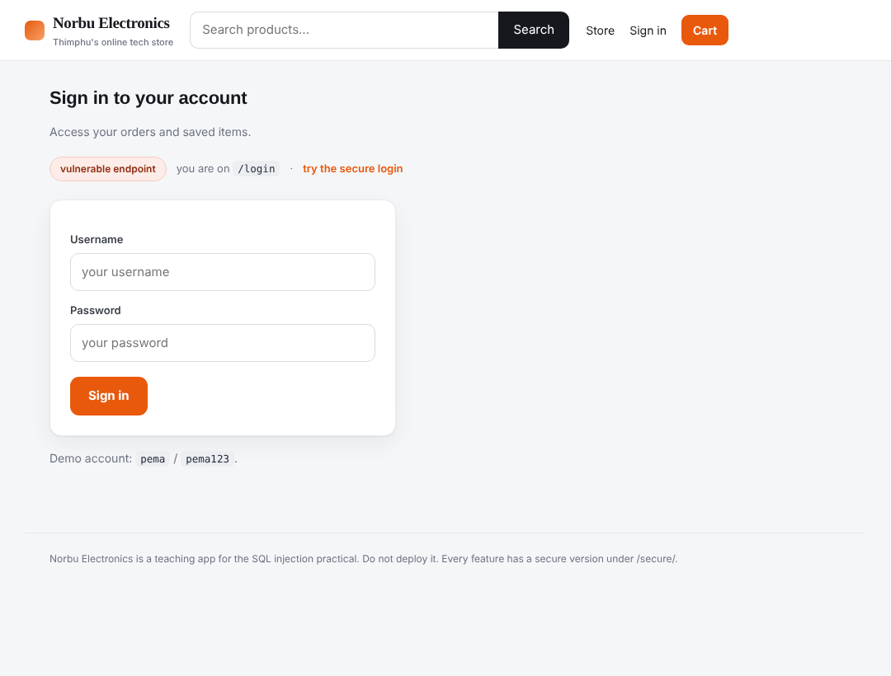

In the username box I typed `ashis.chettri'-- ` and any password. The query becomes:

```
SELECT id, username, role FROM users WHERE username = 'ashis.chettri'--' AND password = 'anything'
```


The `'` closes the username string early, and `--` turns the rest of the line into a comment, so the password check is thrown away. The database looks up the lecturer's account and returns it, and the store signs me straight into the administrator dashboard, which lists every customer account and every order. I never knew the password.

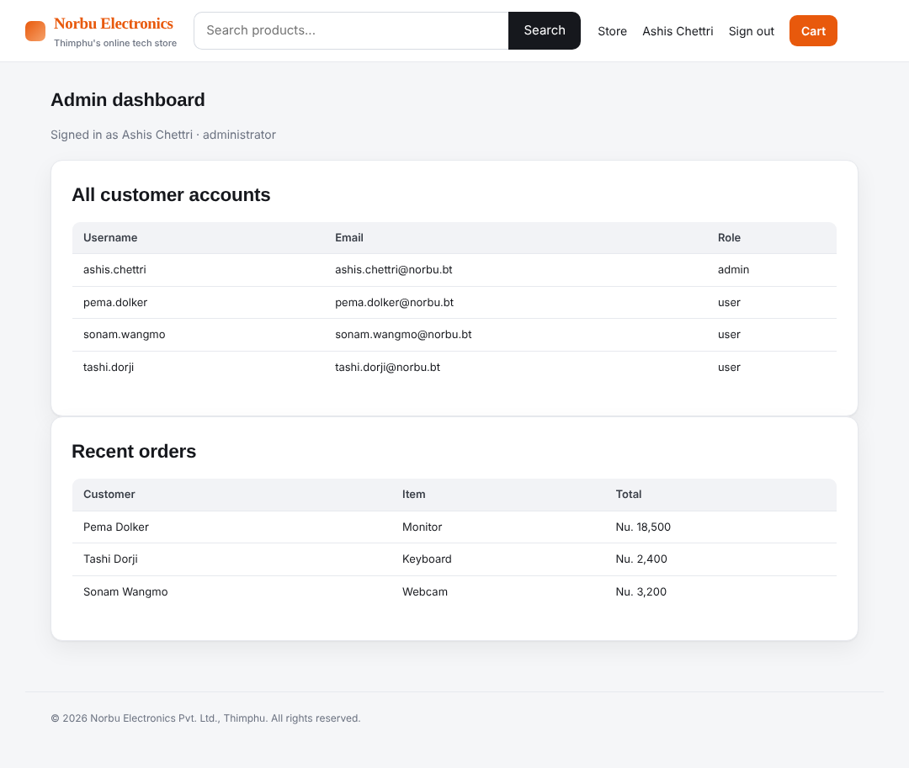

A second payload, `' OR 1=1-- ` in the username, signs in as the first account in the table by making the condition always true.

## 5.2 Error based disclosure

Here I just want the app to leak information. I put a single quote in the input, which breaks the SQL syntax, and the unsafe store shows the raw database error on the page. The error confirms the input is going straight into a query and hints at the query shape, which makes the UNION attack below easier to build. On MySQL or SQL Server this error channel can be pushed further to pull out real data, but SQLite does not have those functions, so here it is an information leak.

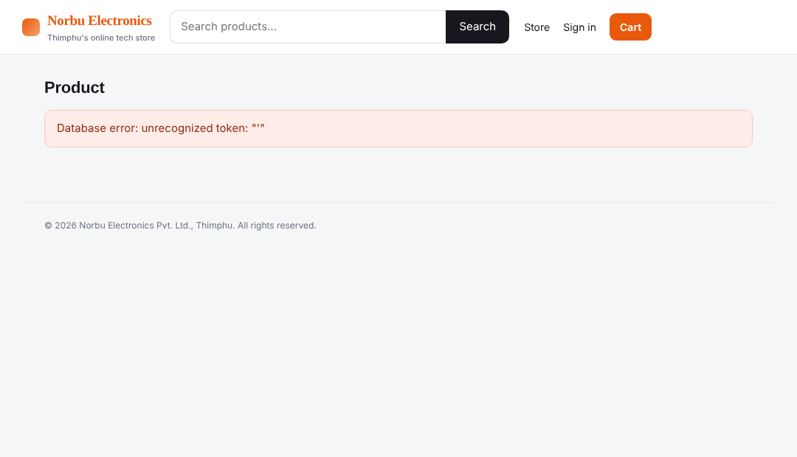

## 5.3 UNION based extraction

This is the strongest in band attack. The `UNION` keyword joins a second query onto the first, so I can select data from any table and have it appear in place of the products.

First I found the column count using `ORDER BY` on the product id, counting up until it errored, which showed the query returns four columns. Then I pulled the whole users table into those four columns with this payload in the product id:

```
0 UNION SELECT username, password, role, email FROM users
```
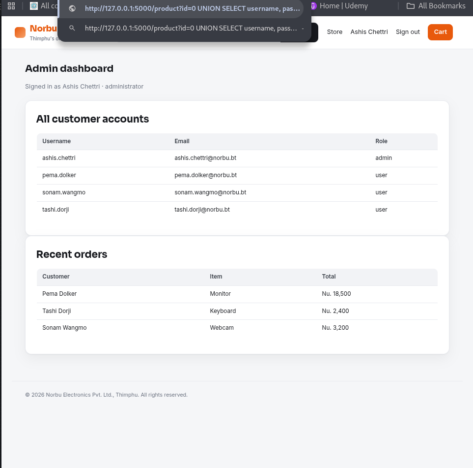

The product listing then showed every account and every password, including the lecturer's administrator password, sitting where the products should be.

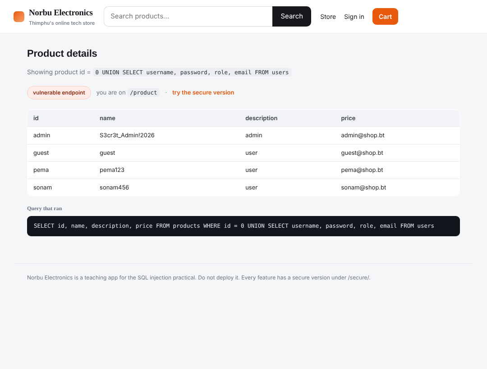

Then I went after the internal table the store never displays:

```
0 UNION SELECT name, value, 'x', 'y' FROM app_secrets
```

That returned the payment gateway key and the database backup password, data that was never meant to leave the server.

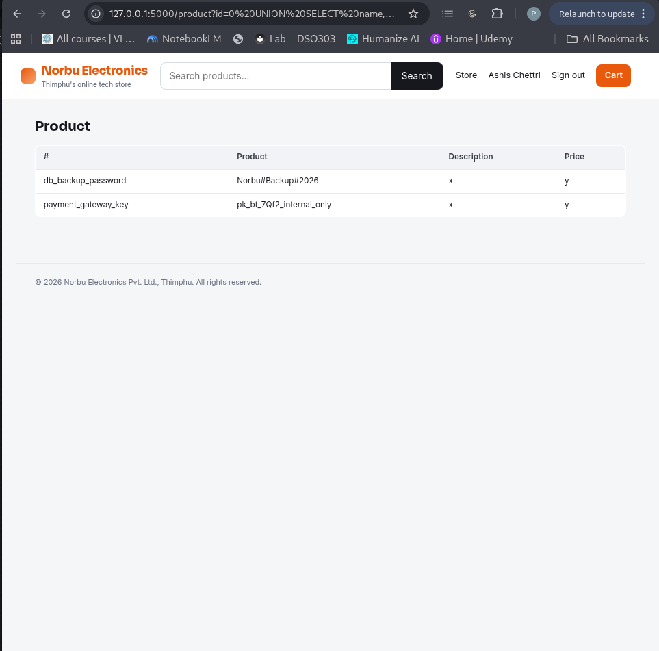

The search box has the same flaw in a string context inside a LIKE clause, so the payload closes the quote first and then adds the UNION.

## 5.4 Boolean based blind

The username checker, used when choosing a username at registration, only ever says "taken" or "available". It never prints data, so I cannot read the password directly. Instead I ask the database yes or no questions and watch which of the two messages comes back. A payload like this asks whether the first character of the administrator password is the letter C:

```
ashis.chettri' AND substr((SELECT password FROM users WHERE username='ashis.chettri'),1,1)='C'-- 
```


If the checker says "taken" the guess was right, if it says "available" it was wrong. Here the same payload with a correct first character returns "taken", and with a wrong one returns "available", which is the yes or no oracle the whole attack rests on.

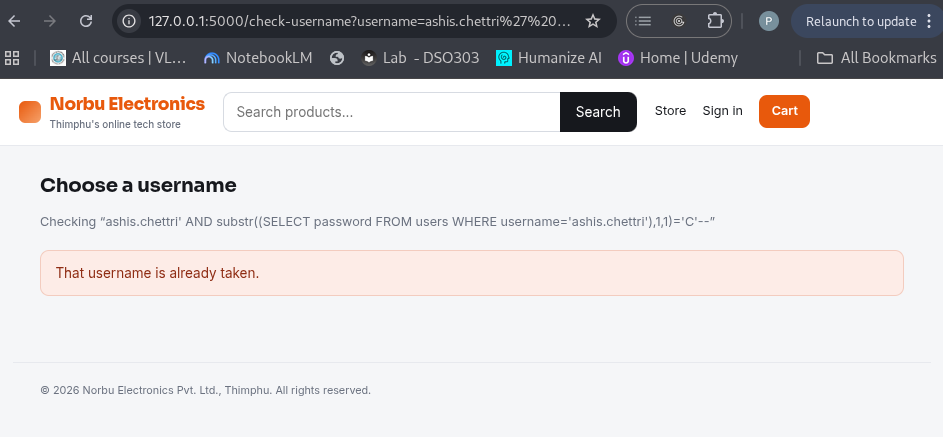

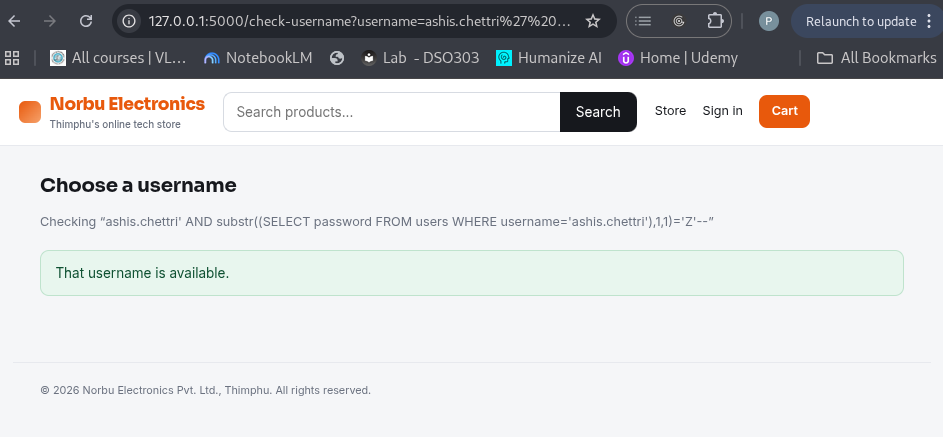

A loop that tries every character at every position reads that one bit over and over and recovered the full administrator password `Ch3ttri@CST!2026`, one character at a time.

## 5.5 Time based blind

This is for the worst case, where the page looks the same no matter what I send. I make the difference be time. I tell the database to run a slow operation only when my guess is correct, then measure the response. A correct guess made the page take about a second, a wrong guess returned instantly, and I recovered the password by reading the clock. There is no screenshot of this one because the whole point is that the page looks identical either way; the timing difference is only visible in the attack run output in section 5.9.

## 5.6 Stacked queries

SQLite can run several statements in one call, and the unsafe view counter uses that feature, so I can append my own statement after a semicolon. With this payload I promoted a normal student account to administrator:

```
1; UPDATE users SET role='admin' WHERE username='tashi.dorji'
```

The first statement bumps the counter as normal, and the second one, which is entirely mine, promotes the account. To prove it, I then signed in as that student, Tashi Dorji, with their own ordinary password, and they now land in the administrator dashboard that only staff should see. This is privilege escalation driven purely by the injected second statement.

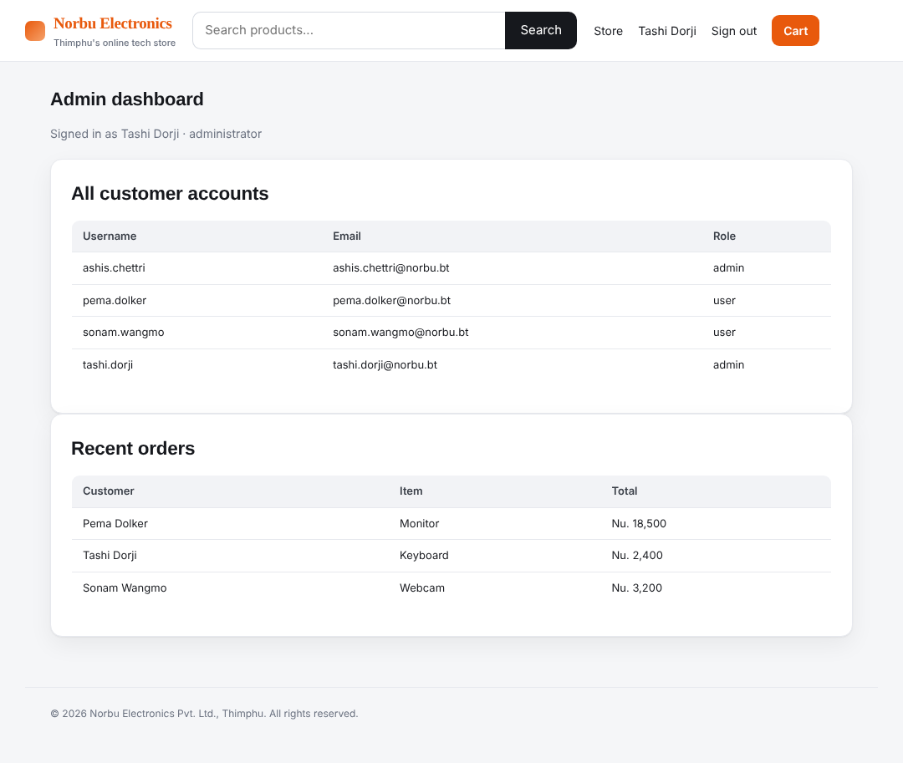

## 5.7 Second order injection

This is the subtle one. In every attack above the input does its damage the moment it is used. In a second order attack the malicious input is stored safely first and only fires later, when another part of the app trusts it. I registered an account with the username `ashis.chettri'-- `. Registration uses a parameterised insert, so the username is stored exactly as typed with no harm. Then I used the password reset feature, which reads my stored username back and concatenates it into an update:

```
UPDATE users SET password = 'pwned_2nd_order' WHERE username = 'ashis.chettri'-- '
```

Because my stored username is `ashis.chettri'-- `, the update now targets the real administrator and the comment removes the rest. The administrator password was changed to my value, so I then signed in to the lecturer's account using the password the attack set, `pwned_2nd_order`, and reached the admin dashboard. The dangerous input came from the database, not from the current request, which is why filtering input only at the entry point misses this.

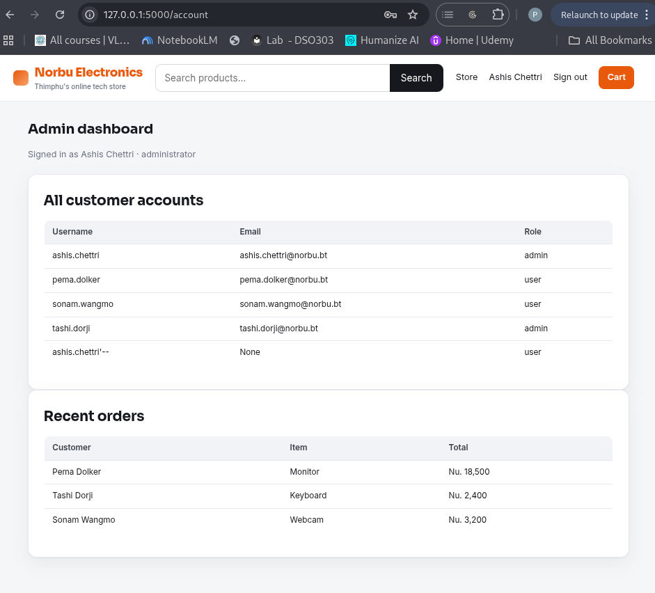

## 5.8 Out of band (explained, not demonstrated)

For completeness, out of band injection is used when there is no useful response and no reliable timing. The attacker makes the database itself open a network connection to a server they control, carrying the stolen data in the request. It needs database and network features my local SQLite setup does not have, so I did not run it, but it is worth knowing because it still works where the other blind methods fail.

## 5.9 The full run

Here is the whole attack script run against the store, so every result can be seen in one place, including the blind and time based password recovery.

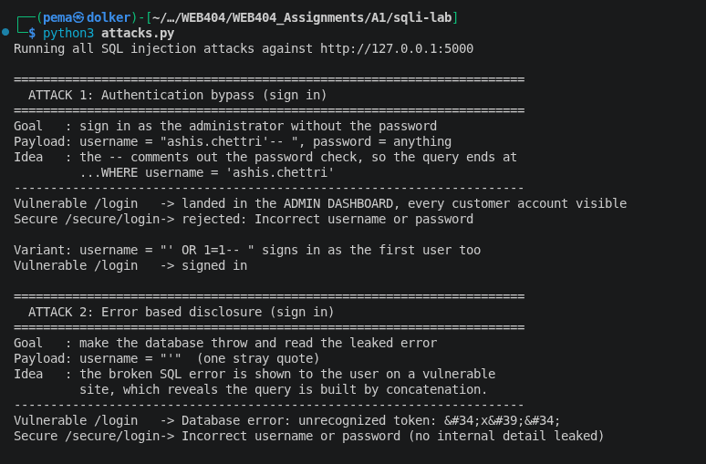

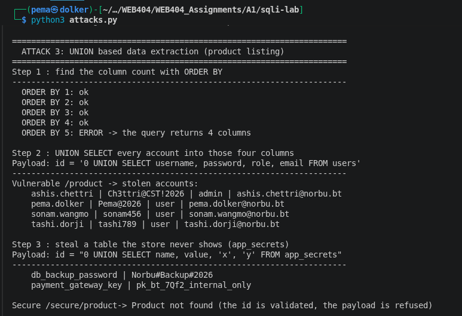

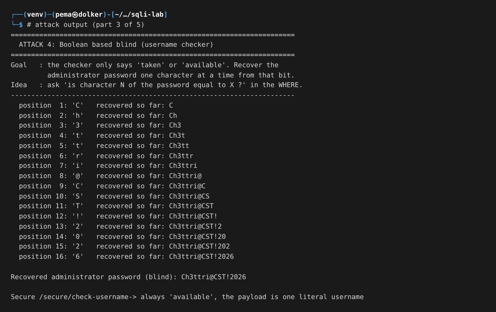

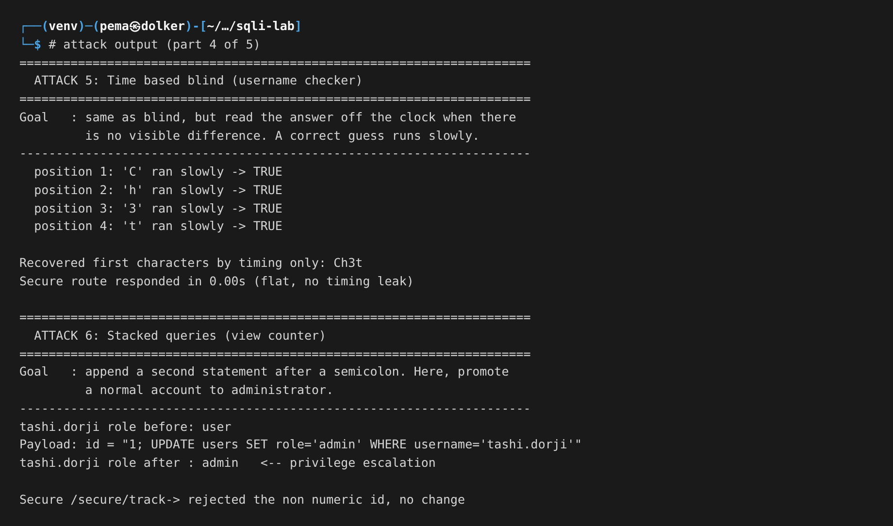

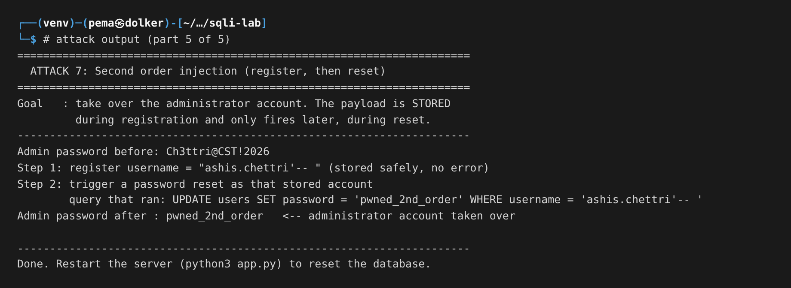

# 6. Securing the application

The fixes come in layers, and the first one is the real cure.

**Parameterised queries.** This is the main fix and every secure route uses it. The query text is fixed and the user input is bound separately, so input can never change the meaning of the query. When I fired the same payloads at the secure routes, the sign in bypass failed, the UNION payload was refused, and the blind loop got "available" every time because the whole payload was treated as one literal username. Here the secure sign in refuses the same bypass that reached the admin dashboard a moment ago.

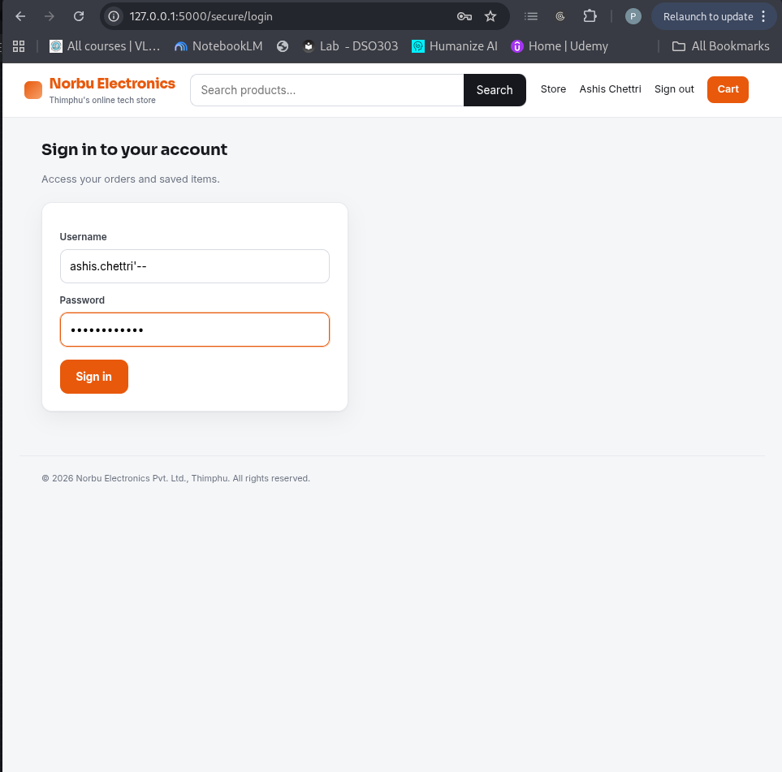

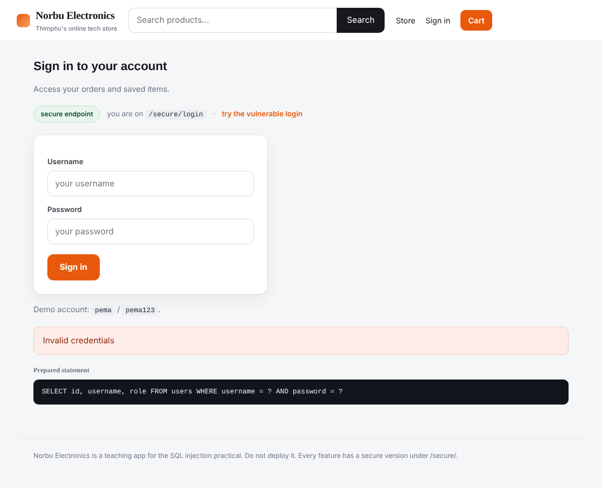

**Input validation.** On the product and view counter routes, a product id must be a whole number, and anything else is refused before a query is built. This is a second layer on top of binding.

**Do not run multiple statements on user input.** The stacked query attack only worked because the counter ran several statements at once. The secure counter uses a single bound statement, which cannot be stacked.

**Treat stored data as untrusted too.** The second order attack is stopped by the same parameterised queries, because data read back out of the database is used as a bound value, not pasted into new SQL.

**Hide database errors.** The secure routes show a plain message instead of the raw database error, so even if something breaks, the attacker learns nothing.

Two more defences belong in a real system. Give the application database account only the permissions it needs, so a stolen query cannot drop tables, and never store passwords in plain text. I kept them in plain text here only so the stolen data is readable in the demo.

# 7. Results summary

| Attack | Result on the store | Same payload on the secure route |
|---|---|---|
| Authentication bypass | Signed in as admin, full dashboard | Incorrect username or password |
| Error based disclosure | Leaked the database error | Generic message, nothing leaked |
| UNION based | Stole all accounts and the hidden secrets | Product not found, refused |
| Boolean blind | Recovered the admin password | Always "available" |
| Time based blind | Recovered the password by timing | Flat response time |
| Stacked queries | Promoted an account to admin | Rejected, no change |
| Second order | Took over the admin account | Stored payload stays inert |

# 8. Conclusion

Every common class of SQL injection worked against the store, from the simple sign in bypass to the blind, timing, stacked, and second order variants. The attacks reached data the site never exposed, changed account roles, and took over the administrator account, all against an app that looked completely normal. After switching the queries to parameterised statements and adding input validation, every one of the same payloads failed. The main lesson is that cleaning input by hand is fragile, but separating the query from the data with bound parameters removes the whole class of bug at once.

# 9. References

- OWASP, SQL Injection and the SQL Injection Prevention Cheat Sheet
- PortSwigger Web Security Academy, SQL injection
- Python documentation, sqlite3 module, on placeholders and parameter substitution
