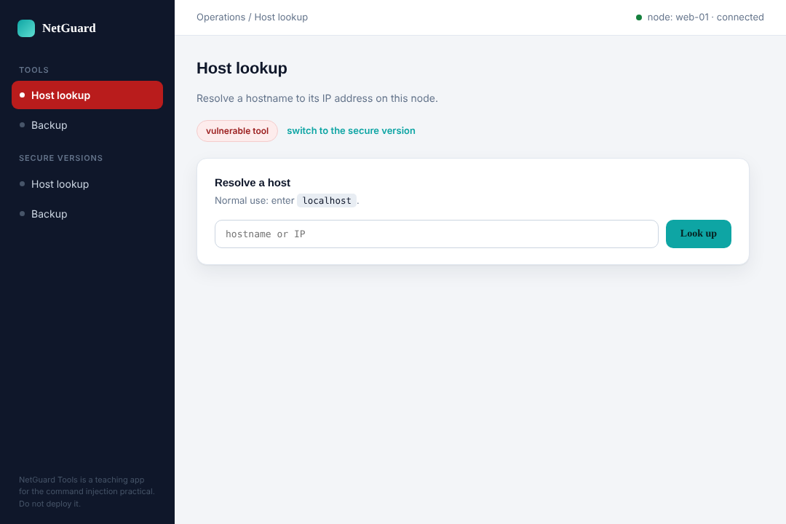
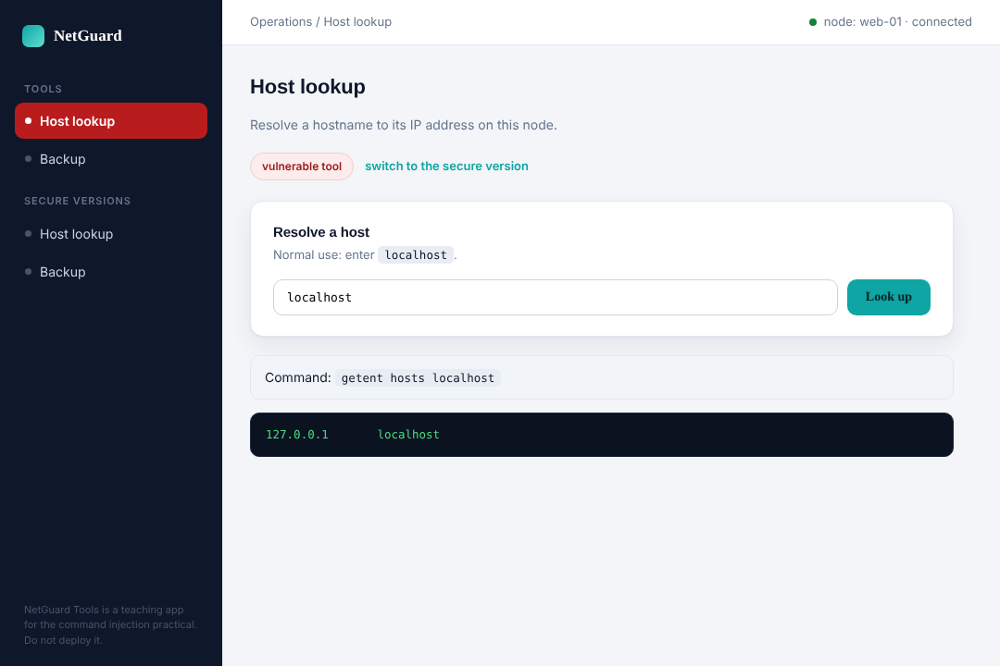
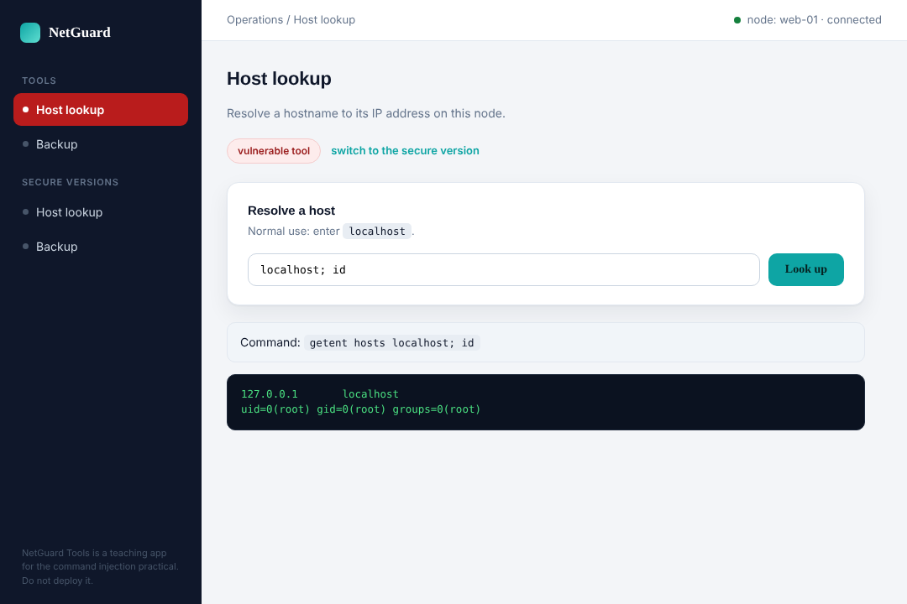
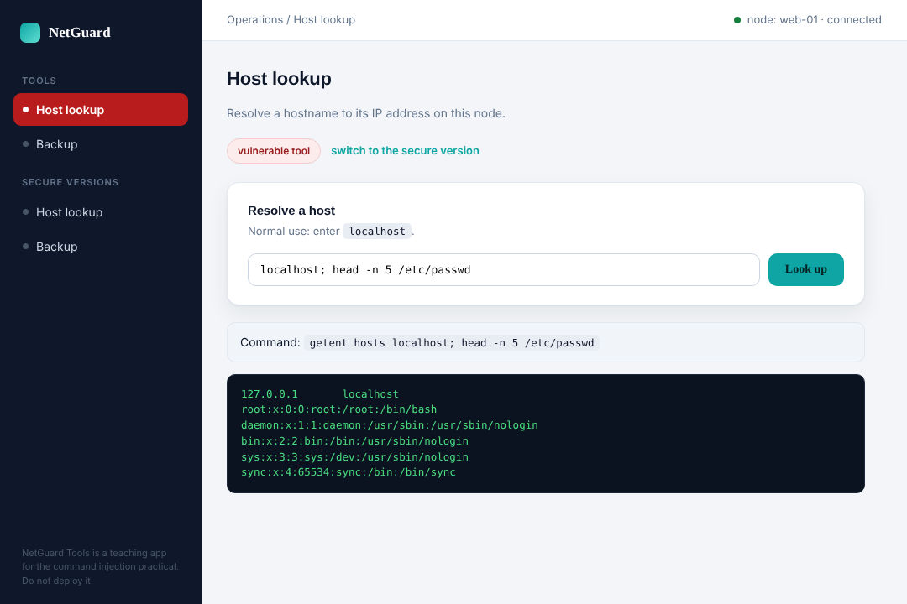
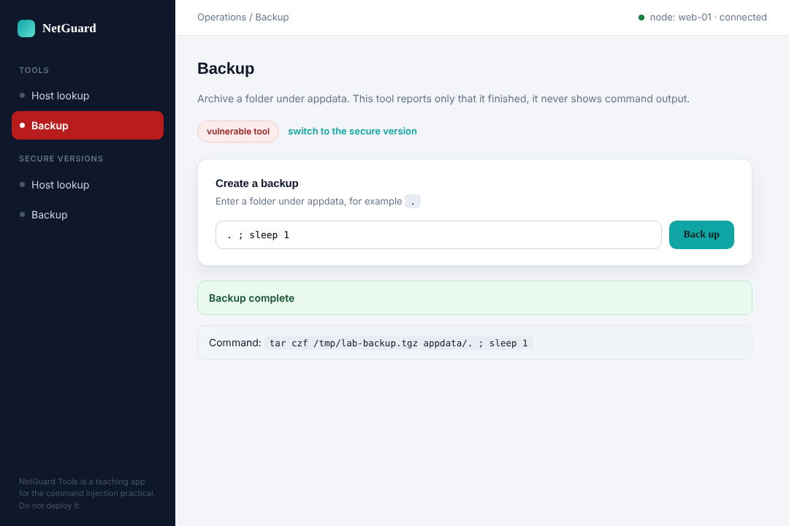
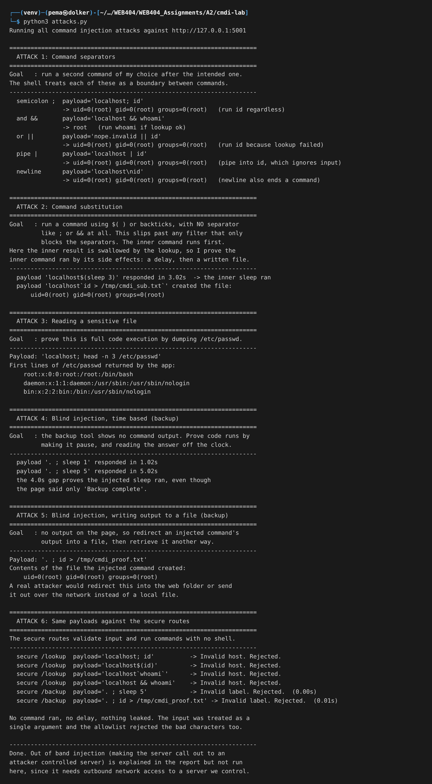
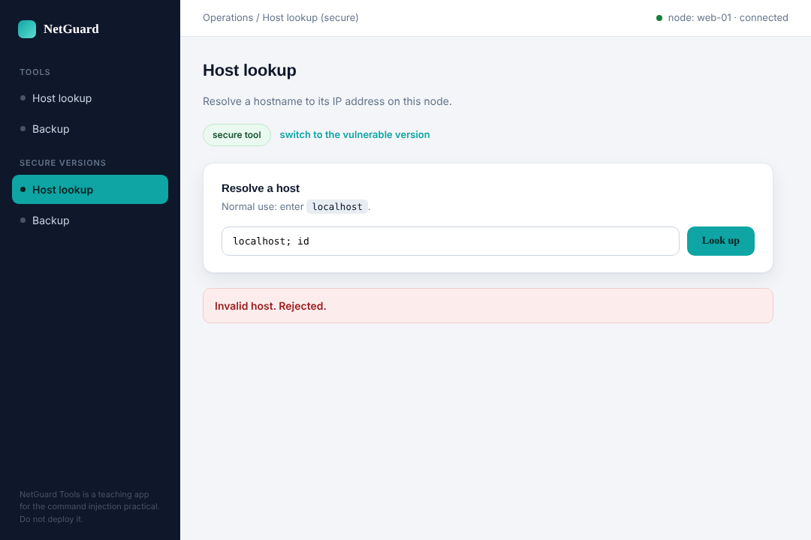

# Assignment 2- Lab : Command Injection

# 1. Objective

The task was to build a web application that runs operating system commands based on user input, show how that lets an attacker run their own commands on the server, cover the common ways of doing it, and then fix the application so the same attacks no longer work.

To make it realistic I built a small server operations console called NetGuard Tools, the kind of admin panel a sysadmin might use. It has two command line tools. One resolves a hostname and shows the output, and one runs a backup and only says it finished. One shows output and one does not, so I can demonstrate both normal injection and blind injection.

# 2. Tools used

- Python 3 with the Flask web framework for the console
- The Python subprocess module, which is how the app runs system commands
- The getent and tar commands as the real commands the tools wrap
- The Python requests library to send the attack payloads
- Firefox to use the console and take screenshots

The console runs on `http://127.0.0.1:5001`. Each tool exists twice, a normal version at `/lookup` and `/backup` and a secure version at `/secure/lookup` and `/secure/backup`. Both do the same job, so any difference in behaviour comes only from how the command is run.

# 3. What command injection is

Command injection happens when an application builds an operating system command by joining fixed command text with input from the user, and then hands the whole string to a shell to run. The shell reads certain characters, like a semicolon or `&&` or `$( )`, as instructions rather than as plain text. So if the user input contains those characters, the shell treats the injected part as extra commands and runs them.

It is worth noticing that this is the same shape of bug as SQL injection. In SQL injection the untrusted input is mixed into a query string sent to the database. In command injection the untrusted input is mixed into a command string sent to the shell. Different interpreter, same mistake, and as it turns out, the same style of fix. That is why the two are usually taught together.

Here is the console. The host lookup tool is the in band target.

 

Used normally, it just resolves a name to an IP.



# 4. The one mistake behind every attack

The unsafe lookup runs its command like this, building one string and handing it to the shell:

```
command = "getent hosts " + host
subprocess.run(command, shell=True)
```

The whole thing is one string, and `shell=True` means that string is given to the shell, which interprets any special characters inside it. That setting, combined with pasting input into the string, is the entire bug.

The secure version runs the same command like this:

```
subprocess.run(["getent", "hosts", host], shell=False)
```

The program and its arguments are a list, and there is no shell. The value in `host` is only ever passed as a single argument, so even if it contains a semicolon or `$( )`, those characters are just part of a useless hostname and are never run as commands.

One thing about impact. The injected commands run as whatever user the web server runs as. In my run that was root, so the attacker effectively owns the machine. If the server ran as a low privilege user instead, the damage would be smaller. That is the least privilege idea, and it matters here.

# 5. The attacks

## 5.1 Command separators

A shell lets you put several commands on one line using separators. Each of these worked on the host lookup tool, and each ran my command as root.

- Semicolon: `localhost; id` runs the lookup and then runs `id` no matter what.
- And: `localhost && whoami` runs `whoami` only if the lookup succeeded.
- Or: `nope.invalid || id` runs `id` because the lookup failed first.
- Pipe: `localhost | id` sends the lookup output into `id`.
- Newline: a newline character also ends one command and starts the next.

Here is the semicolon payload. The page shows the command that ran and then the output, which includes `uid=0(root)` from my injected `id`, not from the lookup.



## 5.2 Command substitution

This technique runs a command using `$( )` or backticks, with no separator at all. That matters because a weak defence that only blocks `;` and `&&` will miss this completely. The lookup swallowed the inner result into a broken hostname, so I proved the inner command ran by its side effects instead: `localhost$(sleep 3)` made the page take about three seconds to answer, and a backtick payload wrote a file I could then read. Both prove the injected command executed even with no separator in the payload.

## 5.3 Reading a sensitive file

To show this is full code execution and not just a trick, I dumped part of the system password file with the payload `localhost; head -n 5 /etc/passwd`. The page returned the first lines of `/etc/passwd`, including the root entry. From here an attacker could read config files, keys, or anything else the server user can read.



## 5.4 Blind injection, time based

The backup tool never shows command output, so I cannot read results directly. The standard trick for this is to inject a delay and measure the response time. The payload `. ; sleep 1` answered in about one second, and `. ; sleep 5` answered in about five seconds. The gap proves my sleep command ran, even though the page only ever said "Backup complete". By swapping the sleep for a conditional sleep, an attacker can ask yes or no questions and read the answer off the clock, the same way blind SQL injection works.



## 5.5 Blind injection, writing output to a file

Timing proves a command ran but does not hand over data. To actually steal data from a blind spot, I redirected an injected command's output into a file with `. ; id > /tmp/cmdi_proof.txt`. The page said only "Backup complete", but the file appeared on disk containing the `id` output. In a real attack the attacker would redirect this into a folder served by the website so they could fetch it with a browser, or send it out over the network.

## 5.6 Out of band (explained, not demonstrated)

For completeness, out of band injection is used when there is no output and no reliable timing. The attacker makes the server itself reach out to a server they control, for example with an injected request that carries the stolen data inside a hostname. I did not run this because it needs outbound access to a server I own, but it is important because it still works in locked down setups where the other blind methods fail.

## 5.7 The full run

Here is the whole attack script run against the console, with every technique and its result in one place.



# 6. Securing the application

The fixes come in layers, with the first one being the real cure.

**Do not use a shell. Pass arguments as a list.** This is the main fix and every secure route uses it. With `shell=False` and the command given as a list, the user input is only ever one argument, and no character in it is ever interpreted. When I fired all the separator and substitution payloads at the secure routes, nothing ran, because the whole payload was treated as one meaningless hostname or filename. Here is the secure lookup refusing the same `localhost; id` payload that gave root a moment ago.



**Validate input against an allowlist.** On top of the no shell rule, the secure routes check the input with a strict pattern. A hostname may only contain letters, digits, dots and hyphens. A backup label may only contain safe path characters and may not contain `..`. Anything else is refused before any command is built. This is why the secure routes answered every payload with "Invalid host" or "Invalid label".

**Avoid calling the operating system at all where possible.** The safest option is to not shell out in the first place. For many tasks there is a library that does the job inside the language with no shell involved. Python can create a tar archive with its own tarfile module and resolve a host with its socket module, so no external command is needed.

**Run with least privilege.** The web server should run as a low privilege account, never root, so that if something does slip through, the attacker inherits very little power.

# 7. Results summary

| Technique | Result on the unsafe tool | Same payload on the secure tool |
|---|---|---|
| Separators (; && \|\| \| newline) | Ran my commands as root | Rejected, nothing ran |
| Command substitution $( ) and backticks | Ran my commands with no separator | Rejected, nothing ran |
| Read /etc/passwd | Dumped the password file | Rejected |
| Blind, time based | 5 second delay proved code ran | No delay |
| Blind, file write | id output written to disk | No file written |

# 8. Conclusion

Every common form of command injection worked against the console, from the simple separators to substitution, blind timing, and blind file writing, all running as root. After switching to argument lists with no shell and adding input validation, every one of the same payloads was stopped. The key lesson matches the SQL injection lab: the danger comes from mixing untrusted input into a string that an interpreter will parse, and the fix is to keep the command and the data separate rather than trying to clean the data by hand.

# 9. References

- OWASP, Command Injection and the OS Command Injection Defense Cheat Sheet
- PortSwigger Web Security Academy, OS command injection
- Python documentation, subprocess module, on shell=False and passing an argument list
