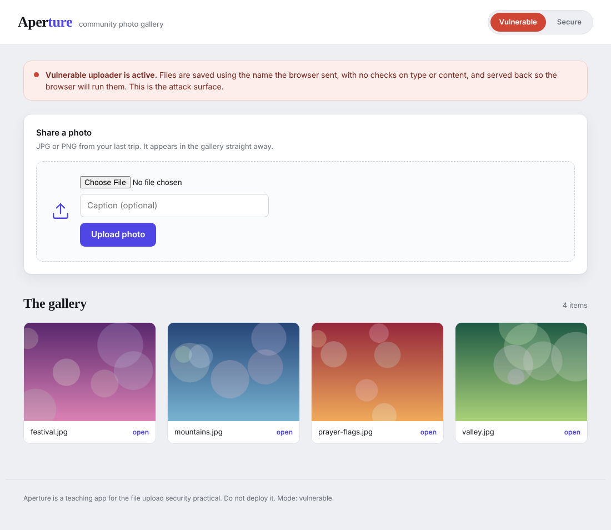
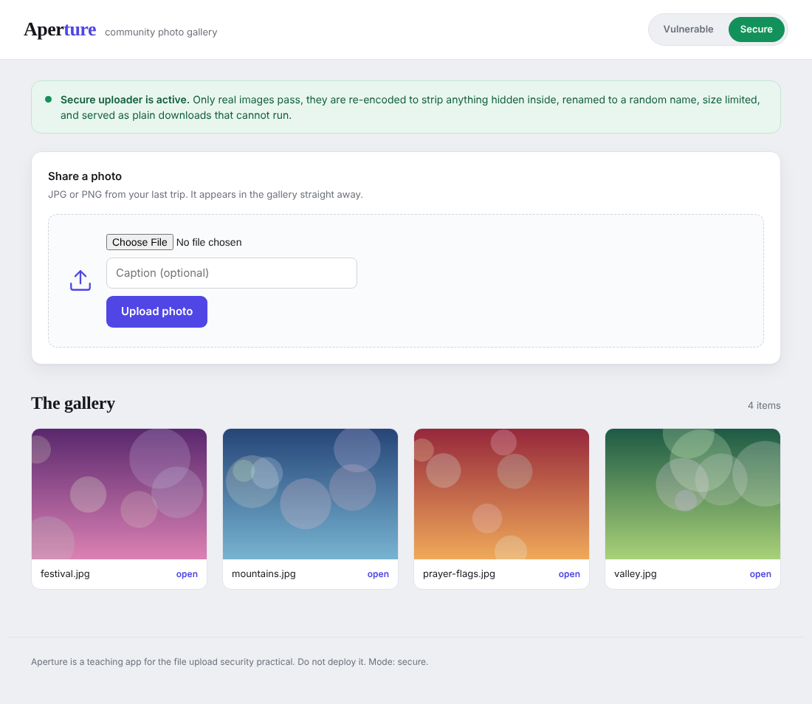
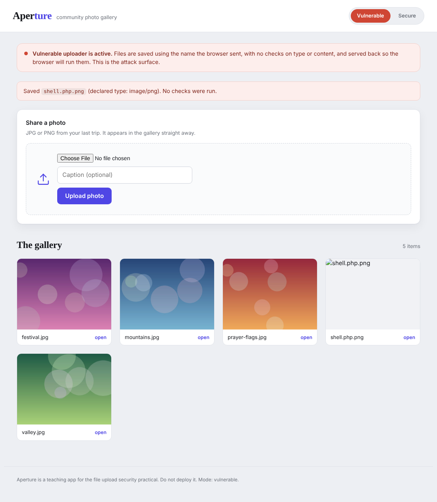
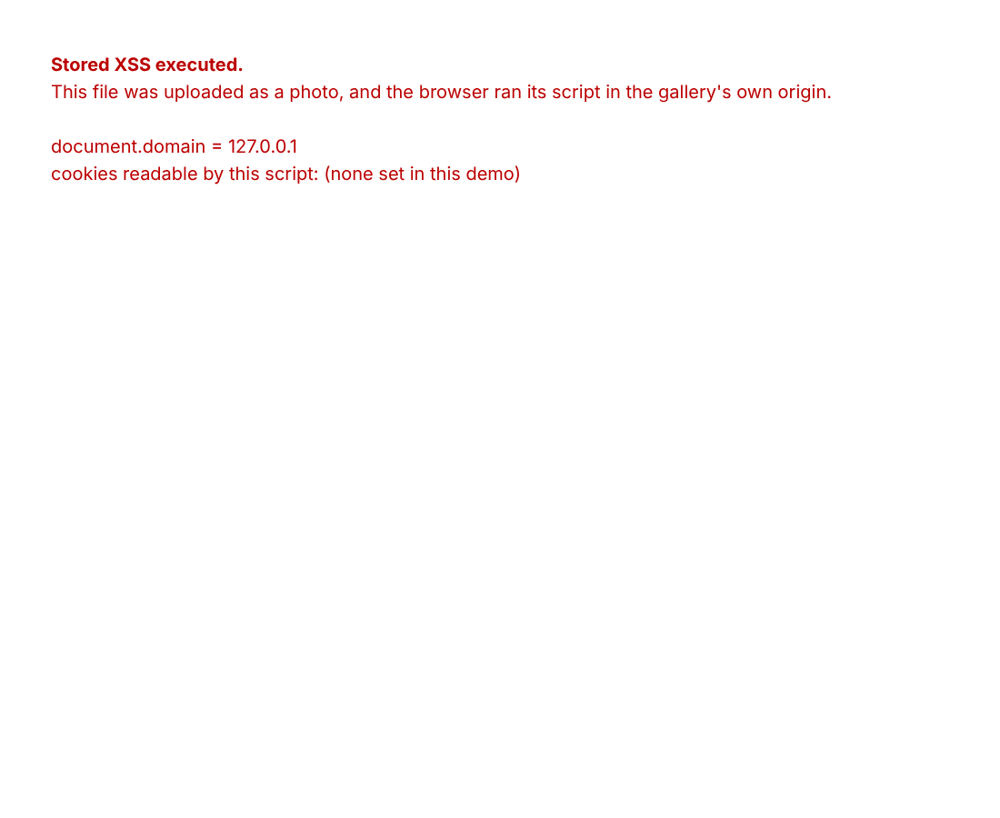
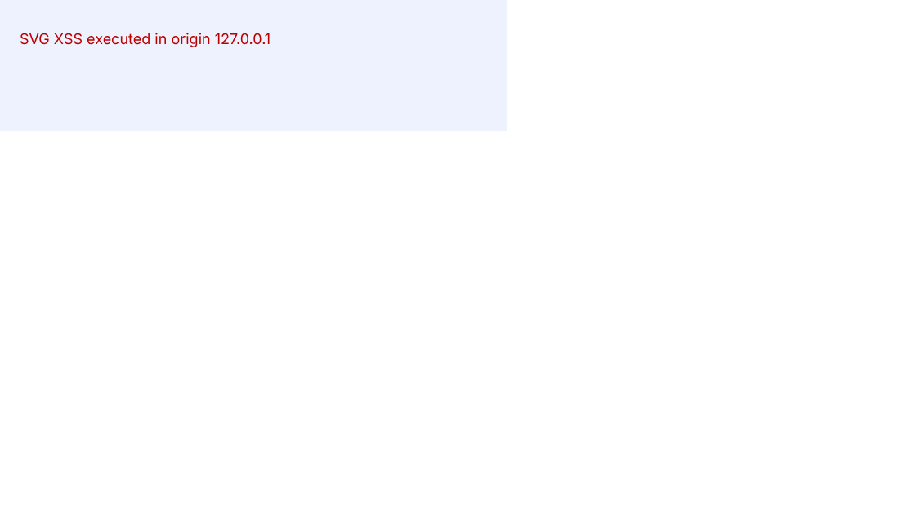
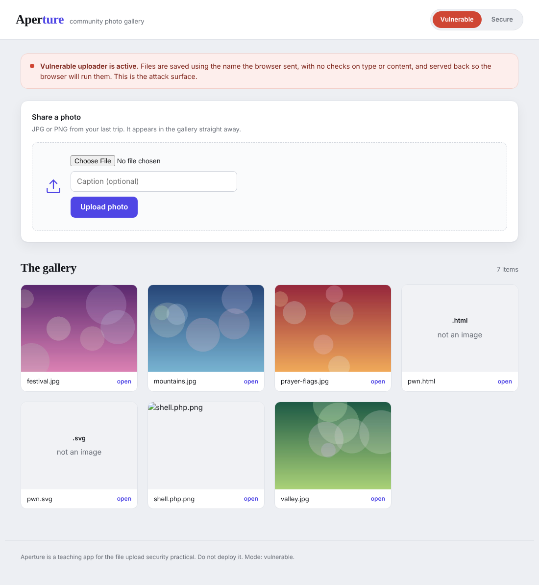
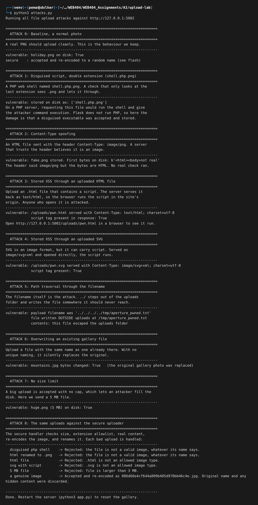
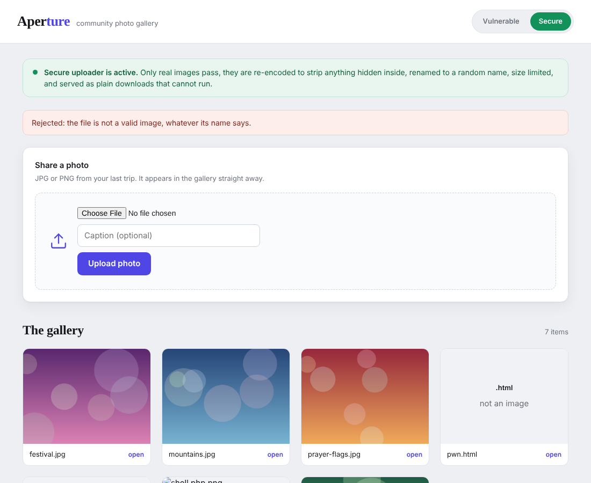
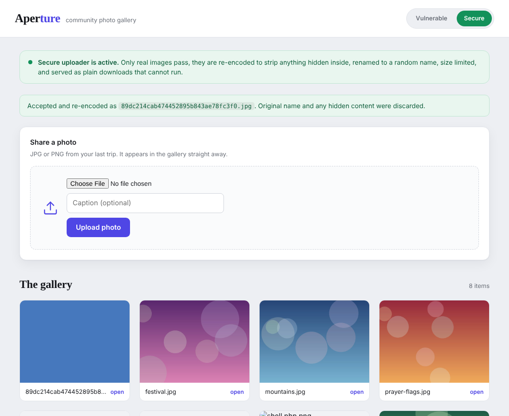

# Assignment 3 - Lab : Malicious File Upload


# 1. Objective

The task for this practical was to build a web application with a file upload feature, show how a careless upload feature can be abused, and then add security measures that stop the abuse. The brief says to prevent malicious file uploads, so I wanted to cover the whole topic and not just one trick. That means showing the different kinds of malicious upload, how each one works, and then a single secure version that defends against all of them.

To make it feel like a real feature and not a toy form, I built a small photo gallery app called Aperture where a user picks a picture and it shows up in a gallery. The upload box is the thing everyone attacks in the real world, so that is a fair and realistic target.

# 2. Why file upload is dangerous in the first place

Most input on a website is a short piece of text, like a name or a search term. A file upload is different. The user hands the server a whole file, and the server usually has to do three things with it: save it somewhere, remember its name, and later give it back to other users. Every one of those three steps is a place where the user, who is a stranger, gets to influence what the server does. That is a lot of trust to hand to a stranger.

The danger comes from three questions the server has to answer, and the easy answer to each one is the wrong answer.

The first question is what the file is. The easy answer is to believe the extension on the end of the name, or the Content-Type header the browser sends. Both of those are just text chosen by whoever uploaded the file, so an attacker can set them to anything.

The second question is what to call the file when saving it. The easy answer is to keep the name the user gave. But a filename can contain path characters like ../ which tell the operating system to move up and out of the folder, so the name itself can be an attack.

The third question is how to give the file back later. The easy answer is to serve it with a type guessed from its extension and let the browser decide what to do with it. If the browser decides the file is HTML or a script, it will run it, inside the website's own origin.

A secure upload feature is really just a feature that refuses to take the easy answer to any of those three questions. The rest of this report shows what goes wrong when it does take the easy answer, and then the version that does not.

# 3. Tools and setup

- Python 3 with Flask for the application
- Pillow (the Python imaging library) for the secure content checks and for making the sample photos
- The Python requests library to send the attack uploads
- Firefox to view the app and take screenshots

The app has the vulnerable upload at `/upload` and the secure upload at `/secure/upload`. The switch in the top right of the page just changes which of the two the form posts to, so nothing else about the page changes between a safe upload and an unsafe one. The database of the gallery is just a folder of files, and it resets to four seed photos every time the server starts, so the lab repeats cleanly.

# 4. The application

Here is the gallery in vulnerable mode. The red strip states plainly that the uploader is not checking anything.



And the same app in secure mode. Same gallery, same form, only the upload handler behind the form is different.



The one mistake that creates most of the problem is in how the vulnerable handler saves the file. It trusts the name the browser sent and runs no checks:

```
filename = f.filename                       # trust the name the browser sent
dest = os.path.join(UPLOAD_DIR, filename)   # paste it onto the save path
f.save(dest)                                # save whatever bytes arrived
```

Three lines, and all three trust the stranger. The secure handler, shown later, replaces this with checks on size, extension, and real content, a full re-encode of the image, and a brand new random filename.

# 5. The attacks

I will go from the most obvious to the more subtle. All of these were also run automatically by a script, and its full output is shown near the end.

## 5.1 Disguised executable through a double extension

The classic file upload attack is to upload a program instead of a picture. On a server that runs PHP, if I can upload a `.php` file and then open it, the server runs my code and I own the machine. The usual defence people reach for first is to check the extension. A weak version of that check only looks at the end of the name, so I name my web shell `shell.php.png`. The check sees `.png` and is happy, but the real payload is the PHP in the middle.

I uploaded a small PHP web shell named `shell.php.png`. The app accepted it with no complaint and put it straight into the gallery.



My app is Flask, not PHP, so it will not actually run the PHP, and I want to be honest about that. On a PHP server this is the end of the game, full remote code execution. Here the harm is one step short of that: a disguised executable was accepted and stored where the server serves files from, which is exactly the thing that would be fatal on the wrong server. The fix is the same either way, so the lesson holds.

## 5.2 Content-Type spoofing

The second easy check people use is the Content-Type header, because the browser helpfully sends one with each upload. The problem is that the header is set by the client, so an attacker just sets it to a lie. I took a plain HTML file, named it `fake.png`, and sent it with the header `Content-Type: image/png`. The server believed the header and stored it as an image. When I read the file back off the server, the bytes are HTML, not an image at all. So a check based on the header proves nothing.

## 5.3 Stored XSS through an uploaded HTML file

This is the attack that actually does damage in my Flask app, and it is a serious one. I uploaded a file called `pwn.html` that contains a small script. The vulnerable server stored it, and when I open it the server hands it back with the type `text/html`, so the browser treats it as a page and runs the script. Because the file is served from the gallery's own address, the script runs in the gallery's origin, which means it can read that site's cookies and act as the logged in user. This is stored cross site scripting delivered through a file upload.

Here is the uploaded file running in the browser. The page text is written entirely by the injected script, which also prints the origin it is running in.



The reason this works is the third question from earlier. The server guessed the type from the `.html` extension and did not tell the browser to stop sniffing, so the browser ran it. Any visitor who clicks that photo is attacked.

## 5.4 Stored XSS through an SVG

People often allow SVG because it is an image format, but SVG is XML and it can carry a `<script>` tag. I uploaded `pwn.svg` with a harmless looking label and a script hidden inside. Served as `image/svg+xml` and opened on its own, the script runs just like the HTML one did.



This is worth calling out because an allowlist that includes SVG is not safe. SVG needs the same re-encoding or sanitising as everything else, or it should not be allowed at all.

## 5.5 Path traversal through the filename

Here the filename itself is the weapon. I uploaded a file whose name was `../../../../tmp/aperture_pwned.txt`. The `../` parts step up and out of the uploads folder, so the file landed in `/tmp`, well outside where uploads are supposed to go. On a real server an attacker could use this to drop a file into a folder that does get executed, or to overwrite a config file or a script the server trusts. The file write landing outside the uploads folder is proof the name was never cleaned.

## 5.6 Overwriting an existing file

Because the vulnerable app keeps the user's filename, I can upload a file with the same name as one that already exists and replace it. I uploaded a new `mountains.jpg` and the original gallery photo was silently swapped for my file. In a real system this lets one user tamper with another user's content, or replace a trusted static file like a script or a stylesheet with my own.

## 5.7 No size limit

The vulnerable upload accepts a file of any size. I sent a 5 MB file and it was stored without complaint. With no cap, an attacker can send huge files or many files and fill the disk until the service falls over, which is a denial of service.

## 5.8 The gallery after the attacks, and the full run

After the uploads, the gallery is holding the disguised shell and the two script files alongside the real photos. That on its own shows the uploader let through things that are not photos.



Here is the full automated run of all the attacks, so every result can be seen in one place.




# 6. Securing the uploader

The secure handler does not try to spot bad files. That approach, a blocklist of bad things, always loses because there is always one more trick. Instead it decides what a good file is and rejects everything else, and it does this in layers so that if one layer is bypassed the next still holds.

The layers, in the order they run:

**Size limit.** The file is capped at 3 MB before anything else happens. This answers the denial of service upload.

**Extension allowlist.** Only `png`, `jpg`, `jpeg`, `gif` and `webp` are allowed. This is an allowlist, not a blocklist, so a `.php` or `.html` or `.svg` is refused by default rather than needing to be named as bad.

**Real content check.** The bytes are opened as an image with Pillow and verified. This ignores the name and the header completely and looks at what the file actually is. A script renamed to `.png` fails here because it is not a real image.

**Re-encode the image.** The image is opened and saved again from its pixels. Anything hidden in the original file, like a script in the metadata or a polyglot that is both an image and HTML, does not survive being rebuilt, because only the pixels are copied over.

**New random filename.** The user's filename is thrown away and a random one is generated with a safe extension. This single step kills path traversal, the double extension trick, and the overwrite attack all at once, because the attacker no longer controls the name at all.

Here are the three important short pieces of the secure handler. The content check and the rename are the heart of it:

```
Image.open(io.BytesIO(data)).verify()          # fails unless it is a real image
img = Image.open(io.BytesIO(data)).convert("RGB")
safe_name = f"{uuid.uuid4().hex}.jpg"           # our name, not theirs
img.save(os.path.join(UPLOAD_DIR, safe_name), format="JPEG")
```

Now the same attacks against the secure uploader.

The `.html` script file is refused at the extension layer:


The HTML renamed to `.png` gets past the extension check but is caught by the real content check, because it is not actually an image:



And a genuine photo is accepted, re-encoded, and given a random name. The original name and anything hidden inside it are gone.



The disguised shell, the SVG, and the oversized file are all refused in the same way, each by the first layer that applies to it.

# 7. Results summary

| Attack | Result on the vulnerable app | Result on the secure app |
|---|---|---|
| Double extension shell | Stored as a photo | Rejected, not a real image |
| Content-Type spoof | HTML stored as an image | Rejected, not a real image |
| Stored XSS via HTML | Script runs in the site origin | Rejected at the extension check |
| Stored XSS via SVG | Script runs in the site origin | Rejected at the extension check |
| Path traversal filename | File written outside the folder | Name discarded, cannot happen |
| Overwrite a file | Existing photo replaced | Random name, cannot happen |
| No size limit | 5 MB file accepted | Rejected over 3 MB |

# 8. What a production system would add

My secure handler covers the practical, but a real service would go further, and it is worth knowing what else belongs here.

Store uploads outside the web root, or on a separate storage service, so that even a file that slips through is never in a place the server would execute. Better still, serve user files from a different domain than the app, so that even a stored XSS runs in a throwaway origin with no access to the real site's cookies. Send the files back with a fixed safe Content-Type, the header `X-Content-Type-Options: nosniff` so the browser does not second guess the type, and `Content-Disposition: attachment` for anything that is not meant to be viewed inline. Run an antivirus scan on the stored bytes. And set a Content Security Policy on the site as a backstop against any script that does get through.

# 9. Conclusion

Every common malicious upload worked against the careless version of the feature: a disguised executable, a spoofed content type, stored XSS through both HTML and SVG, a path traversal through the filename, an overwrite, and an oversized file. The pattern behind all of them is the same, the server trusting things the uploader controls, which is the filename, the extension, and the declared type. The secure version does not trust any of those. It checks the real content, rebuilds the image from its pixels, and renames the file itself. With those few layers in place every one of the attacks was stopped, and the honest ones, the real photos, still go through fine.

# 10. References

- OWASP, Unrestricted File Upload, and the File Upload Cheat Sheet
- OWASP, Cross Site Scripting, for the stored XSS through uploads
- PortSwigger Web Security Academy, File upload vulnerabilities
- Pillow documentation, Image.verify and image re-encoding
