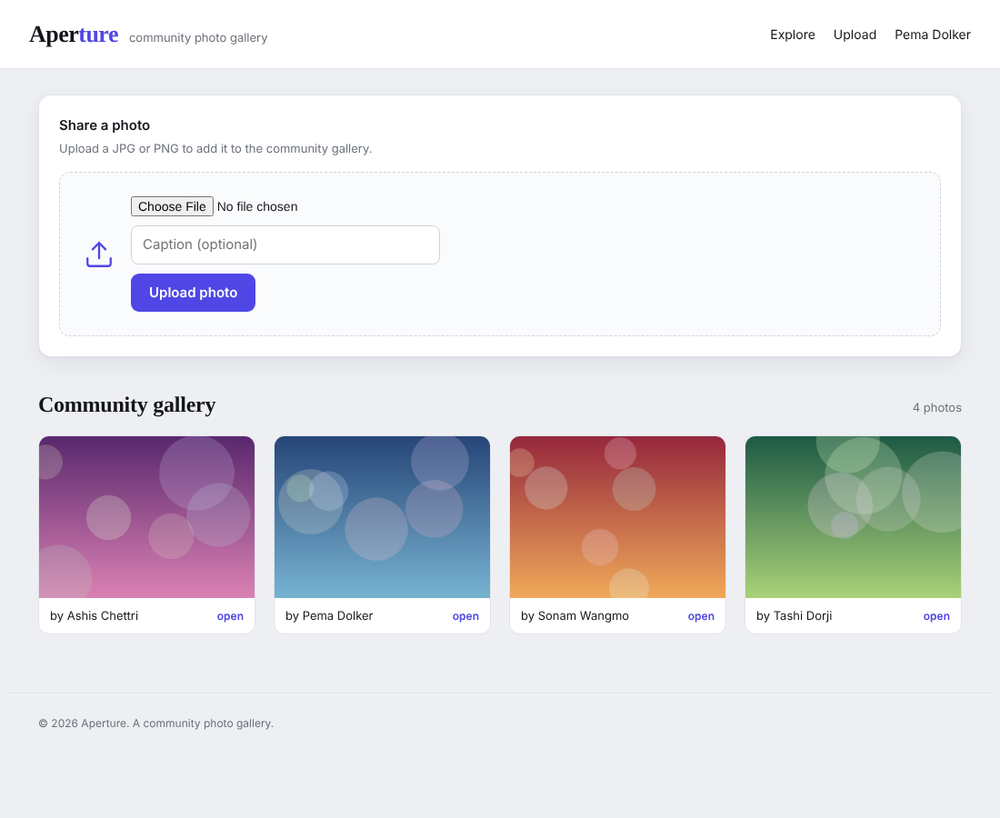
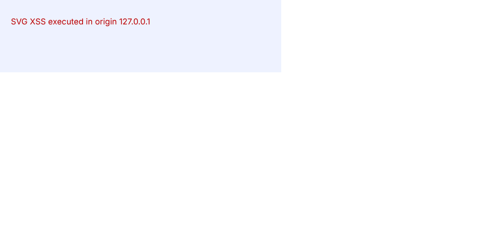
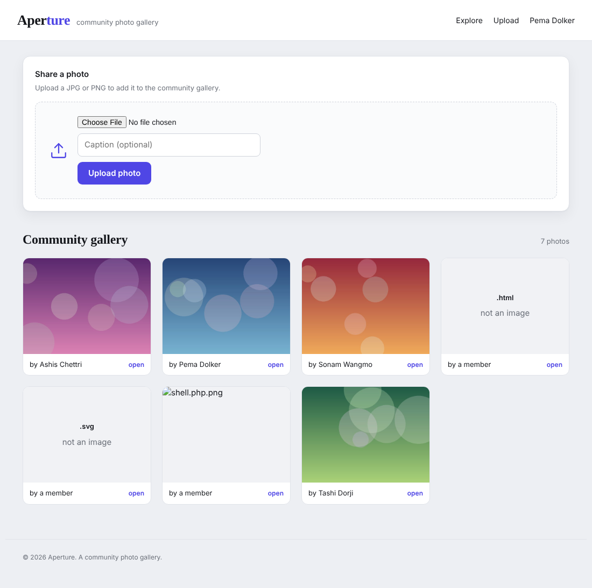
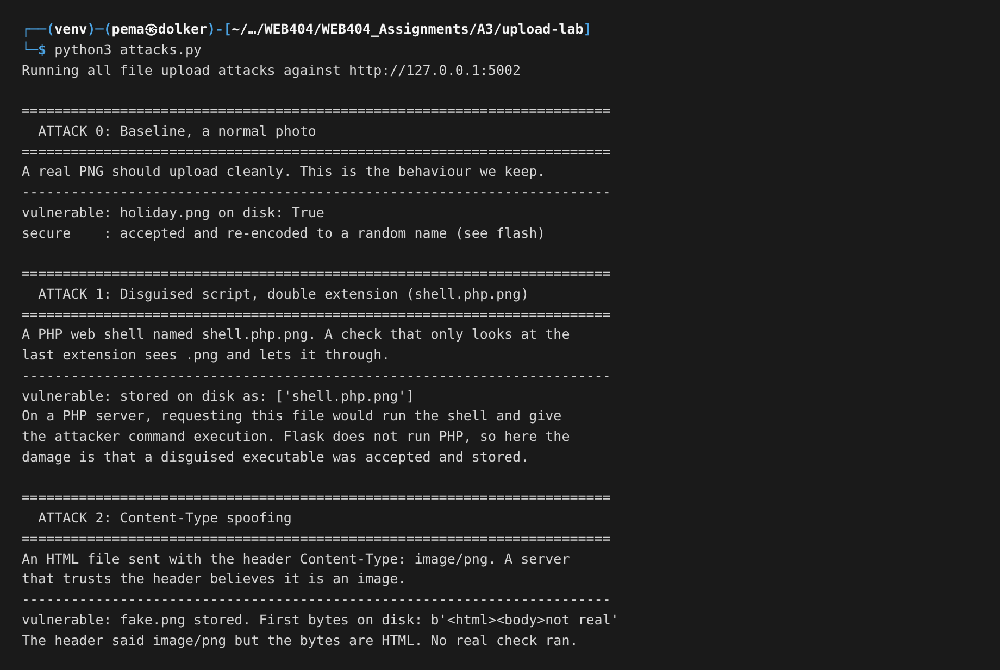
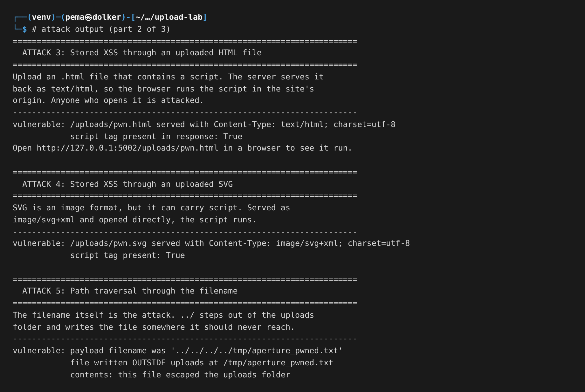
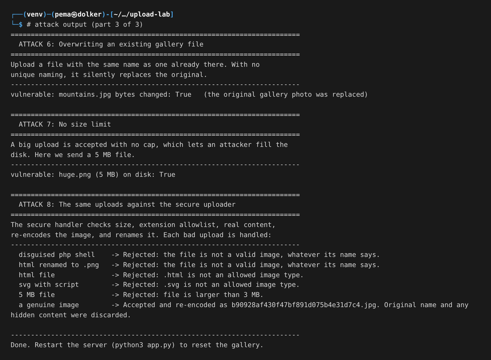
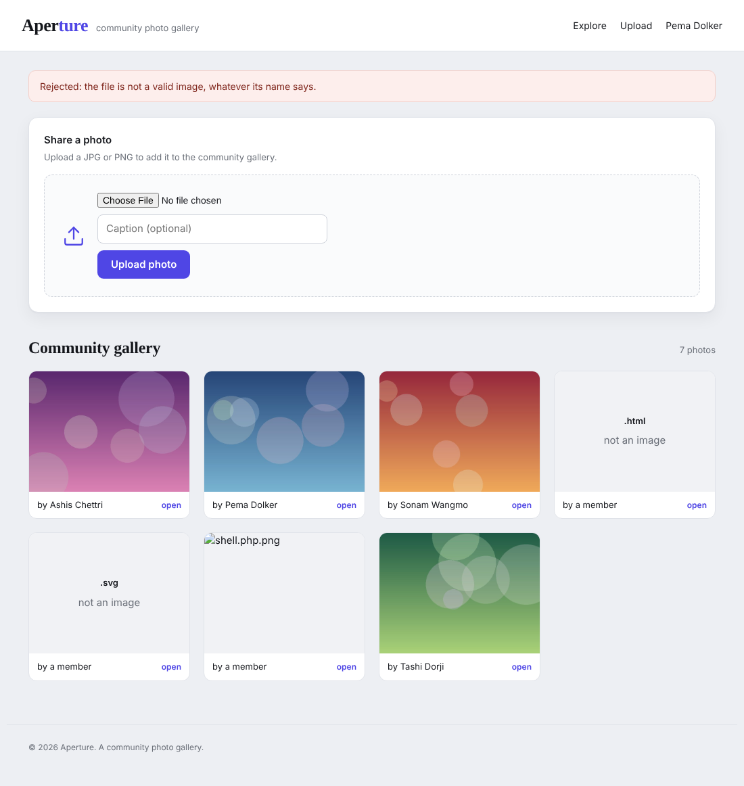
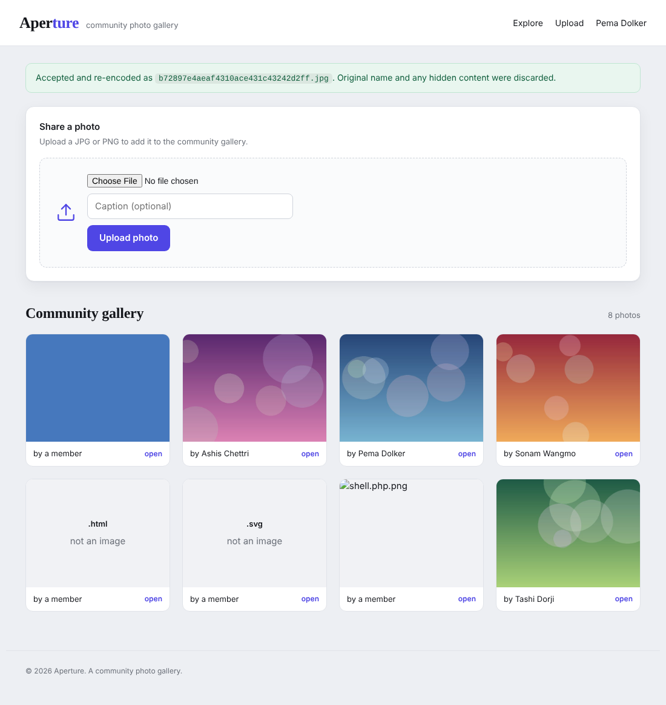

### Assignment 3 - Lab: Malicious File Upload
### Name: Pema Dolker   
### Module:WEB404
### Programme: BE Software Engineering

# 1. Objective

The task was to build a web application with a file upload feature, show how a careless upload feature can be abused, and then add security measures that stop the abuse. I built a small community photo gallery called Aperture where people share pictures. It looks like an ordinary gallery, and nothing on it hints that the uploader is unsafe, which is how a real vulnerable site behaves. The attacks below are what find the flaw, and the secure handler is shown afterwards.

# 2. Why file upload is dangerous in the first place

Most input on a website is a short piece of text. A file upload is different. The user hands the server a whole file, and the server has to save it, name it, and later serve it back to other users. Every one of those three steps is a place where a stranger gets to influence what the server does.

The danger comes from three questions the server has to answer, and the easy answer to each is the wrong one. First, what is the file? The easy answer is to believe the extension or the Content-Type header, both of which are chosen by the uploader. Second, what do we call it? The easy answer is to keep the name the user gave, but a filename can contain path characters like ../ that climb out of the upload folder. Third, how do we give it back? The easy answer is to serve it with a type guessed from the extension and let the browser decide what to do, and if the browser decides it is HTML, it runs it. A secure uploader is one that refuses the easy answer to all three.

Here is the gallery. It looks like a normal community site, with photos shared by members.



# 3. Tools used

- Python 3 with Flask for the application
- Pillow for the secure content checks and for making the sample photos
- The Python requests library to send the attack uploads
- Firefox to use the gallery and take screenshots

The gallery runs on `http://127.0.0.1:5002`. The upload handler at `/upload` is the real, unsafe one. A hardened handler lives at `/secure/upload`, used in this report to show the before and after. The database resets to four seed photos on every start.

# 4. The one mistake behind most of the problem

The unsafe handler saves the file by trusting the name the browser sent and running no checks:

```
filename = f.filename                       # trust the name the browser sent
dest = os.path.join(UPLOAD_DIR, filename)   # paste it onto the save path
f.save(dest)                                # save whatever bytes arrived
```

Three lines, and all three trust the stranger. The secure handler replaces this with checks on size, extension and real content, a full re-encode of the image, and a brand new random filename.

# 5. The attacks

## 5.1 Disguised executable through a double extension

The classic file upload attack is to upload a program instead of a picture. On a server that runs PHP, uploading a `.php` file and opening it runs the attacker's code. A weak extension check only looks at the end of the name, so I named my web shell `shell.php.png`. The check sees `.png` and is happy, but the real payload is the PHP in the middle. The gallery accepted it and added it straight to the page.

My app is Flask, not PHP, so it will not actually run the PHP, and I want to be honest about that. On a PHP server this is full remote code execution. Here the harm is one step short: a disguised executable was accepted and stored where files are served from, which is the fatal step on the wrong server.

## 5.2 Content-Type spoofing

The second easy check is the Content-Type header, but the browser sets it, so an attacker lies. I took a plain HTML file, named it `fake.png`, and sent it with the header `Content-Type: image/png`. The server believed the header and stored it as an image, even though the bytes are HTML.

## 5.3 Stored XSS through an uploaded HTML file

This is the attack that actually does damage in my app, and it is a serious one. I uploaded a file called `pwn.html` containing a script. The server stored it, and when it is opened the server hands it back as `text/html`, so the browser runs the script. Because the file is served from the gallery's own address, the script runs in the gallery's origin and can read its cookies and act as the logged in user. This is stored cross site scripting through a file upload.


## 5.4 Stored XSS through an SVG

People often allow SVG because it is an image format, but SVG is XML and can carry a `<script>` tag. I uploaded `pwn.svg` with a harmless looking label and a script inside. Served as `image/svg+xml` and opened on its own, the script runs just like the HTML one.



After these uploads the gallery is holding the disguised shell and the two script files alongside the real photos, which on its own shows the uploader let through things that are not photos.



## 5.5 Path traversal through the filename

Here the filename itself is the weapon. I uploaded a file whose name was `../../../../tmp/aperture_pwned.txt`. The `../` parts climb out of the uploads folder, so the file landed in `/tmp`, well outside where uploads should go. On a real server this lets an attacker drop a file into a folder that gets executed, or overwrite a config file the server trusts.

## 5.6 Overwriting an existing file

Because the unsafe handler keeps the user's filename, I uploaded a file with the same name as an existing photo and replaced it. In a real system this lets one user tamper with another user's content, or replace a trusted static file like a script with their own.

## 5.7 No size limit

The unsafe upload accepts a file of any size. I sent a 5 MB file and it was stored without complaint. With no cap, an attacker can fill the disk until the service falls over, which is a denial of service.

## 5.8 The full run

Here is the whole attack script run against the gallery, with every result in one place.







# 6. Securing the uploader

The secure handler does not try to spot bad files, because a blocklist of bad things always loses. Instead it decides what a good file is and rejects everything else, in layers.

**Size limit.** The file is capped at 3 MB before anything else happens, which answers the denial of service upload.

**Extension allowlist.** Only `png`, `jpg`, `jpeg`, `gif` and `webp` are allowed, so a `.php`, `.html` or `.svg` is refused by default. Here the secure handler refuses the `.html` script file.


**Real content check.** The bytes are opened as an image with Pillow and verified. This ignores the name and the header and looks at what the file actually is, so an HTML file renamed to `.png` is caught here.



**Re-encode the image.** The image is opened and saved again from its pixels, so anything hidden in the original file, like a script in the metadata or a polyglot, does not survive the rebuild.

**New random filename.** The user's filename is thrown away and a random one is generated. This single step kills path traversal, the double extension trick, and the overwrite attack at once, because the attacker no longer controls the name. A genuine photo is accepted and re-encoded under a new name.



# 7. Results summary

| Attack | Result on the unsafe uploader | Result on the secure uploader |
|---|---|---|
| Double extension shell | Stored as a photo | Rejected, not a real image |
| Content-Type spoof | HTML stored as an image | Rejected, not a real image |
| Stored XSS via HTML | Script runs in the site origin | Rejected at the extension check |
| Stored XSS via SVG | Script runs in the site origin | Rejected at the extension check |
| Path traversal filename | File written outside the folder | Name discarded, cannot happen |
| Overwrite a file | Existing photo replaced | Random name, cannot happen |
| No size limit | 5 MB file accepted | Rejected over 3 MB |

# 8. What a production system would add

A real service would store uploads outside the web root or on separate storage, so a file that slips through is never in a place the server executes. Better still, serve user files from a different domain, so even a stored XSS runs in a throwaway origin with no access to the real site's cookies. Send files back with a fixed safe Content-Type, the header `X-Content-Type-Options: nosniff`, and `Content-Disposition: attachment` for anything not meant to be viewed inline. Run an antivirus scan on the stored bytes, and set a Content Security Policy as a backstop.

# 9. Conclusion

Every common malicious upload worked against the careless gallery: a disguised executable, a spoofed content type, stored XSS through both HTML and SVG, a path traversal, an overwrite, and an oversized file, all against an app that looked completely normal. The pattern behind them is the server trusting things the uploader controls, which is the filename, the extension, and the declared type. The secure handler trusts none of those. It checks the real content, rebuilds the image from its pixels, and renames the file itself. With those layers in place every attack was stopped, and real photos still go through.

# 10. References

- OWASP, Unrestricted File Upload, and the File Upload Cheat Sheet
- OWASP, Cross Site Scripting, for the stored XSS through uploads
- PortSwigger Web Security Academy, File upload vulnerabilities
- Pillow documentation, Image.verify and image re-encoding
