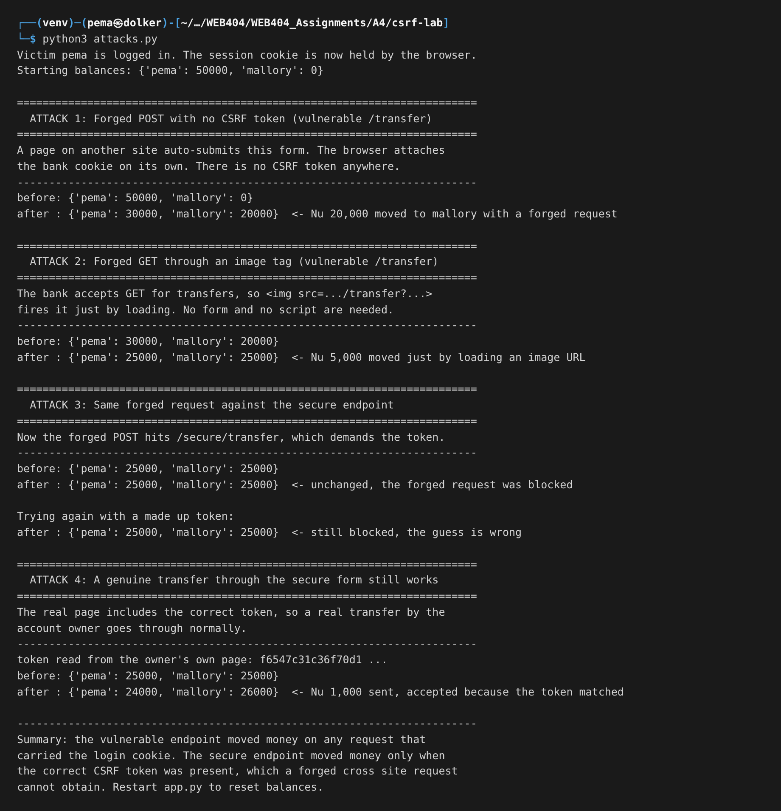
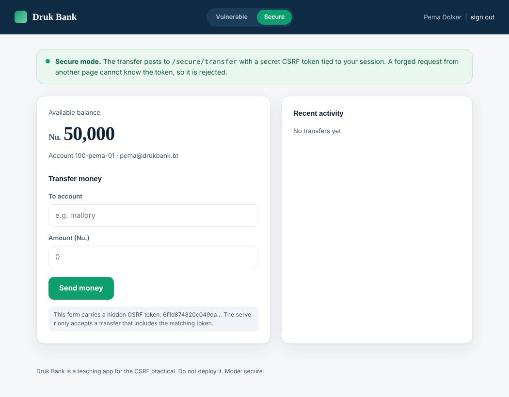
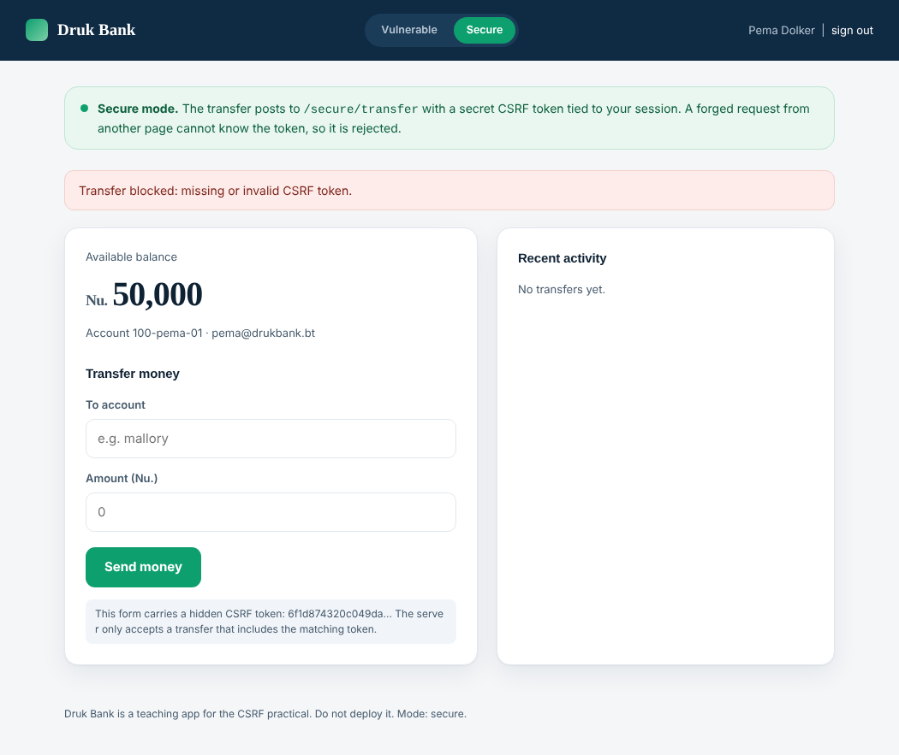

### Assignment4 - Lab  : Cross Site Request Forgery (CSRF)

# 1. Objective

The task was to build a form that is vulnerable to Cross Site Request Forgery, show the attack working, and then add CSRF tokens to stop it. I wanted the form to do something that actually matters, so instead of a toy I built a small online banking app called Druk Bank where the sensitive action is moving money. The whole point of CSRF is that an attacker makes you do something without meaning to, so a money transfer is the clearest way to show the damage.

# 2. What CSRF actually is

CSRF is a strange attack the first time you meet it, because the attacker never steals your password and never sees your data. They just make your own browser send a request you did not intend.

It works because of one helpful thing browsers do. When your browser sends a request to a site, it automatically attaches that site's cookies, including the cookie that says you are logged in. It does this no matter which page caused the request. So if you are logged into your bank in one tab, and you open a different page in another tab, and that other page quietly fires a request at the bank, your browser will attach your bank login cookie to it. The bank sees a request that is fully logged in as you, and it has no way, on its own, to tell that you did not mean to send it.

This is sometimes called the confused deputy problem. The bank is the deputy. It has the authority to move your money, and it acts on your cookie, but it gets tricked into using that authority for a request that really came from the attacker.

So the attacker does not need your password. They only need two things to be true: that you are logged in at the time, and that the sensitive action can be triggered by a request that carries nothing secret except the cookie the browser adds for free. The fix, as we will see, is to make the sensitive action require one more thing that the attacker's page cannot know.

# 3. Tools and setup

- Python 3 with Flask, for both the bank and the attacker site
- The bank runs on `http://127.0.0.1:5003`
- The attacker site runs on `http://127.0.0.1:5004`, a separate server on a separate port, with no access to the bank's cookies or its token
- The Python requests library, for a script that shows the attack at the request level
- Firefox, to run the attack in a real browser

Having the attacker on its own server matters, because that is the real situation. The malicious page is not part of the bank. All it can do is tell your browser to send a request, and let the browser attach the cookie.

The bank has two modes, chosen by the switch at the top. In vulnerable mode the transfer form posts to `/transfer`, which checks only the login cookie. In secure mode it posts to `/secure/transfer`, which also requires a CSRF token.

# 4. The application

Here is the bank in vulnerable mode, logged in as Pema with a balance of fifty thousand.

The login that gets us here is a normal session login. Once you sign in, the bank sets a session cookie, and from then on your browser sends it with every request to the bank.

# 5. The attacks

## 5.1 Forged POST through an auto submitting form

This is the main attack. The attacker builds a page that contains a hidden form aimed at the bank's transfer endpoint, with the fields already filled in to send money to the attacker's account. A tiny script submits the form the moment the page loads. The victim does not click anything.

The attacker's page just looks like a prize lure while it does its work.

I was logged into the bank in the same browser, then I opened that attacker page. The hidden form submitted to the bank, my browser attached my bank cookie, and the bank carried out the transfer. The result is the bank's own page, showing my balance drained to zero and the money gone to mallory.

I never filled in a transfer. I never pressed send. Opening one page on another site was enough.

## 5.2 Forged GET through an image tag

The vulnerable bank makes a second mistake on top of the first: it accepts the transfer as a GET request, not just a POST. That turns the attack into something even simpler. Any tag that makes the browser fetch a URL can carry the attack, and the easiest one is an image.

The attacker page here just claims to show a cat. The real content is an invisible one pixel image whose source is the transfer URL. The browser tries to load the image, which sends the GET request, which moves the money.

This is why a state changing action should never be reachable by GET. GET requests are fired by images, link previews, and prefetching, so a GET that moves money can go off almost anywhere.

## 5.3 Why the cookie alone is not proof of intent

The important thing to notice in both attacks is that the forged request is indistinguishable, to the server, from a real one. It arrives with the same session cookie because the browser attached it. I even sent a foreign Origin and Referer header in my script, and the vulnerable endpoint did not care. The server had nothing in the request that only the real page could have produced. That missing thing is exactly what the token adds.

Here is the full run at the request level, showing both forgeries succeeding and then being blocked once the token is in place.

# 6. The fix: a CSRF token

The defence is called a synchronizer token. When the bank builds the real transfer page for you, it puts a long random secret into a hidden field in the form, and it remembers that same secret in your session on the server. When the form is submitted, the bank checks that the secret in the form matches the one in your session. A real submission from the real page has it. A forged submission from the attacker's page does not, because the attacker's page was never given the token and has no way to read it out of your session or your other tab.

In secure mode the form carries that hidden token, shown in the note under the form.

Then I pointed the attacker's page at the secure endpoint instead. It submits the same forged transfer, but with no token, because it cannot know one. The bank rejects it and the balance does not move.

The token works because it breaks the one assumption the attack relies on. The attack assumed that carrying the cookie was enough. Now the request also has to carry a secret that only the genuine page could have had, and the cross site page cannot get it, because of the same origin rules that stop one site from reading another site's pages.

## 6.1 The other layers

The token is the main fix, but a real app uses more than one layer.

**SameSite cookies.** A cookie can be marked SameSite, which tells the browser not to attach it to requests that come from another site. The modern browser default is SameSite Lax, which already blocks the basic cross site POST. I should be honest about one thing in my own demo: two different ports on `127.0.0.1` count as the same site, not different sites, so SameSite did not block my attacker page here, and that is why the token is the defence I actually demonstrated. Across real different domains, SameSite Lax or Strict is a strong extra layer, and it is worth setting.

**Do not use GET for actions.** As the image attack showed, a state changing GET is dangerous on its own. Transfers, deletes, and settings changes should be POST only.

**Check the Origin or Referer header.** For a sensitive POST, the server can check that the request came from its own site and reject it otherwise. This is a useful backstop, though it should not be the only defence because those headers are not always present.

**Re-authenticate for the most sensitive actions.** For something like a large transfer or a password change, asking for the password again stops a forged request cold, because the attacker does not have it.

# 7. Results summary

| Attack | Result on the vulnerable bank | Result on the secure bank |
|---|---|---|
| Forged POST, no token | Money transferred | Blocked, invalid token |
| Forged GET via image | Money transferred | Not accepted, POST and token required |
| Forged POST, guessed token | n/a | Blocked, token does not match |
| Genuine transfer by the owner | Works | Works, the real form has the token |

# 8. What a production system would add

Most web frameworks ship CSRF protection that you turn on rather than build by hand, and it is better to use the framework's version than to roll your own. On top of the token it is normal to set SameSite on the session cookie, serve the whole site over HTTPS so the cookie can also be marked Secure, and keep session lifetimes short. For a site that exposes an API, using a custom request header that simple cross site forms cannot set is another common pattern, since a plain HTML form can only send a fixed set of headers.

# 9. Conclusion

The forged transfer worked on the vulnerable bank through both a hidden form and an image tag, and in both cases the victim only had to open a page on another site while logged in. The reason it worked is that the bank treated the login cookie as proof of intent, when the browser attaches that cookie to any request by itself. Adding a CSRF token fixed it, because the token is a secret that only the genuine page holds, and a cross site page cannot read it. After the token was in place the same forged requests were rejected while real transfers by the account owner still went through.

# 10. References

- OWASP, Cross Site Request Forgery, and the CSRF Prevention Cheat Sheet
- PortSwigger Web Security Academy, CSRF
- MDN Web Docs, SameSite cookies
