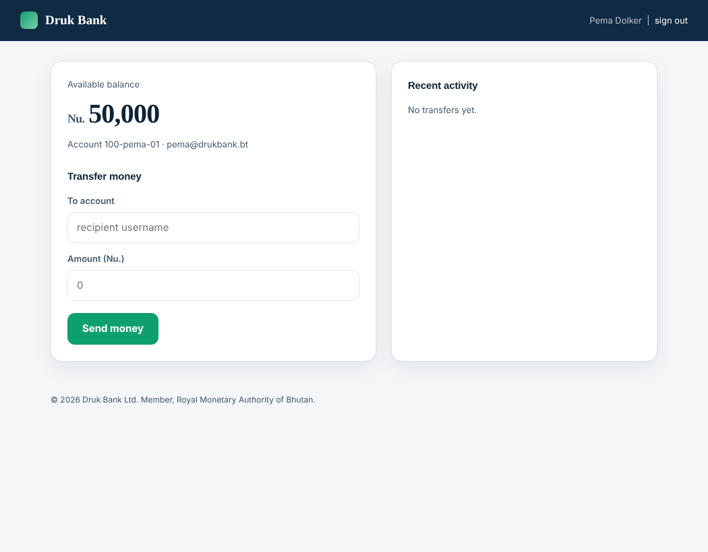
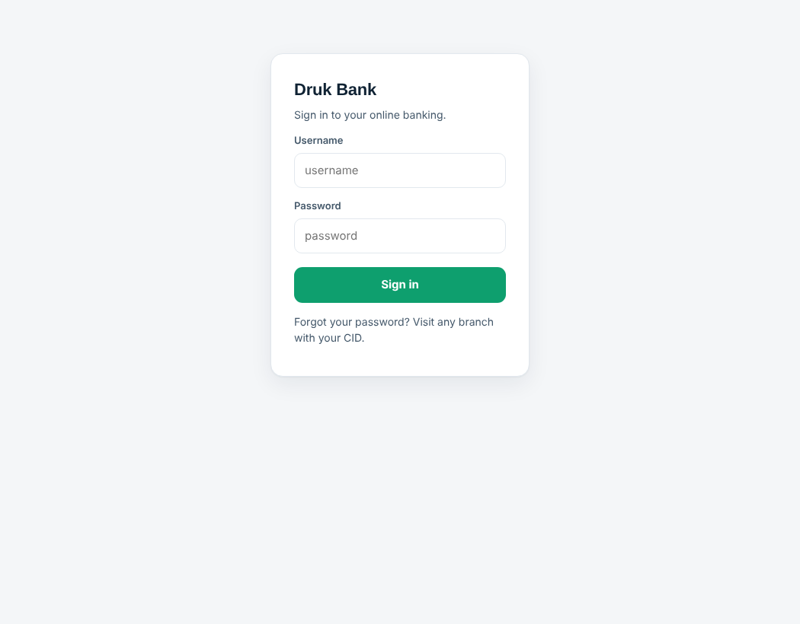
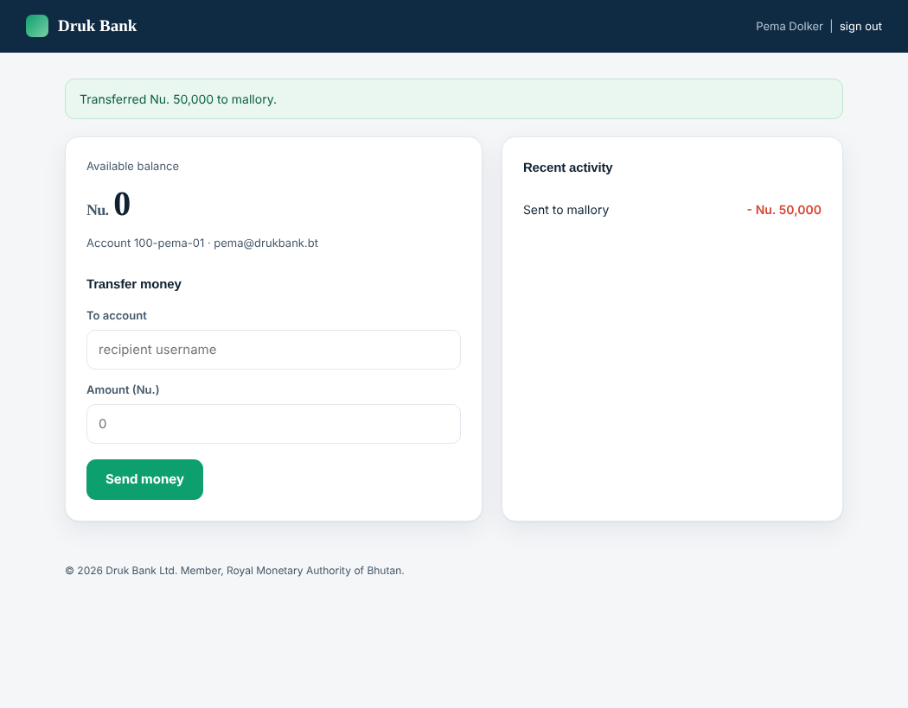
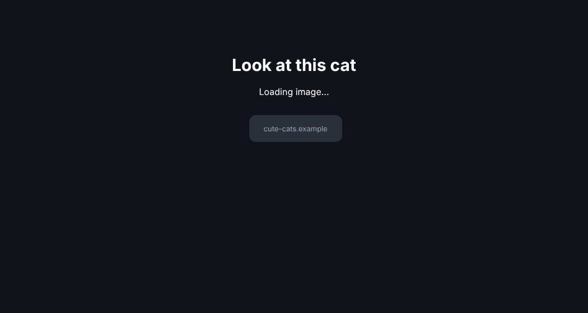
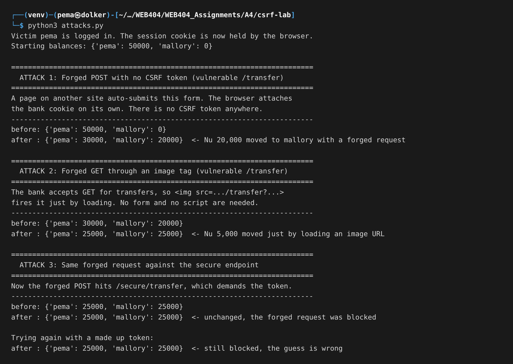
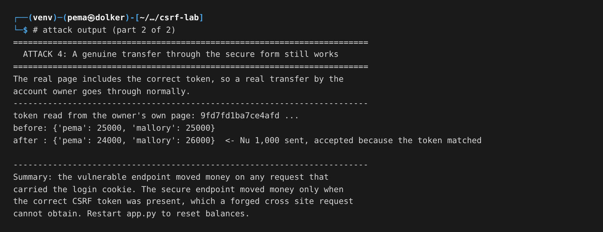
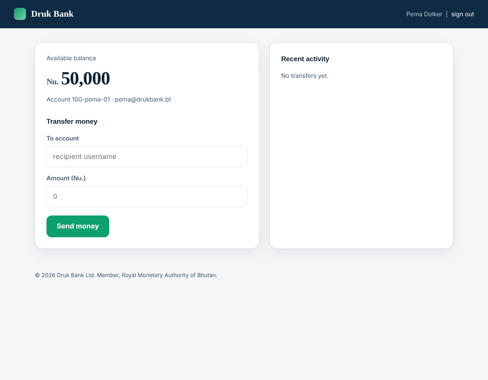
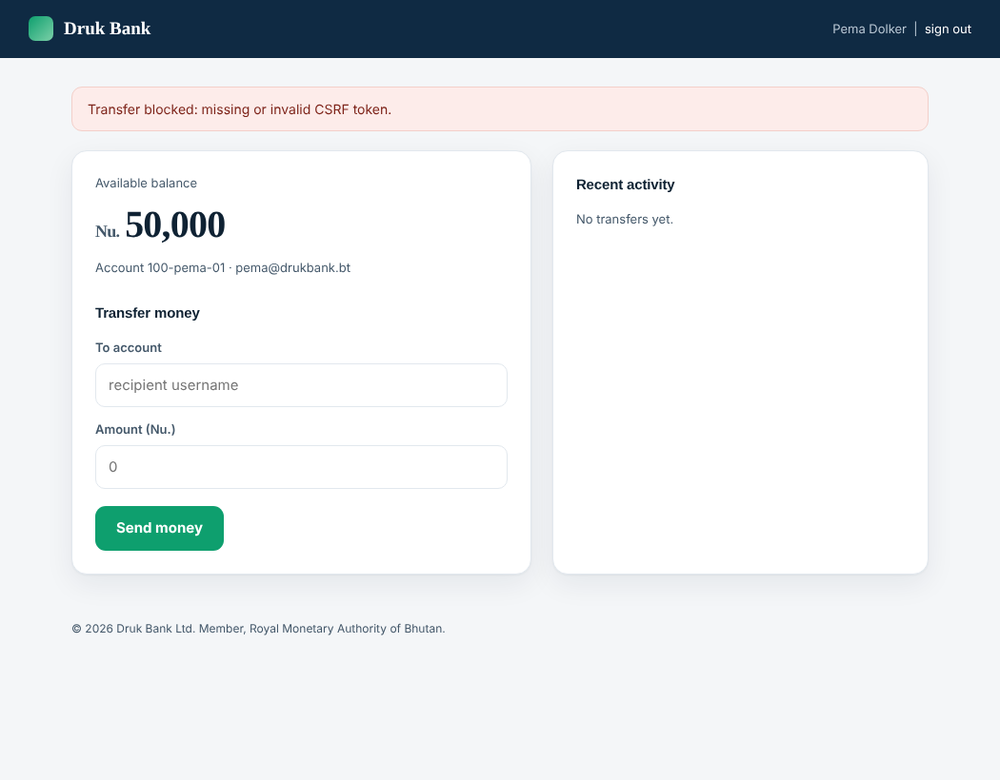

### Assignment 4- Lab : Cross Site Request Forgery (CSRF)
### Name: Pema Dolker   
### Module:WEB404
### Programme: BE Software Engineering

# 1. Objective

The task was to build a form that is vulnerable to Cross Site Request Forgery, show the attack working, and then add CSRF tokens to stop it. I built a small online banking site called Druk Bank where the sensitive action is moving money. It looks like a normal bank, and nothing on it hints at the flaw. The whole point of CSRF is that an attacker makes you do something without meaning to, so a money transfer is the clearest way to show the damage.

# 2. What CSRF actually is

CSRF is a strange attack the first time you meet it, because the attacker never steals your password and never sees your data. They just make your own browser send a request you did not intend.

It works because of one helpful thing browsers do. When your browser sends a request to a site, it automatically attaches that site's cookies, including the cookie that says you are logged in, no matter which page caused the request. So if you are logged into your bank in one tab, and another page quietly fires a request at the bank, your browser attaches your bank login cookie to it. The bank sees a request that is fully logged in as you, and on its own it cannot tell that you did not mean to send it. This is sometimes called the confused deputy problem: the bank has the authority to move your money and acts on your cookie, but gets tricked into using that authority for a request that really came from the attacker.

So the attacker does not need your password. They need you to be logged in at the time, and the sensitive action to be triggerable by a request that carries nothing secret except the cookie the browser adds for free. The fix is to make the sensitive action require one more thing the attacker's page cannot know.

# 3. Tools and setup

- Python 3 with Flask, for both the bank and the attacker site
- The bank runs on `http://127.0.0.1:5003`, and the attacker site on `http://127.0.0.1:5004`, a separate server with no access to the bank's cookies
- The Python requests library, for a script that shows the attack at the request level
- Firefox, to run the attack in a real browser

Having the attacker on its own server matters, because that is the real situation. The malicious page is not part of the bank. All it can do is tell your browser to send a request, and let the browser attach the cookie.

# 4. The application

Here is the bank, signed in as Pema Dolker with a balance of fifty thousand. It is an ordinary banking dashboard.

Getting here is a normal session login. Once you sign in, the bank sets a session cookie, and from then on your browser sends it with every request to the bank.

# 5. The attacks

## 5.1 Forged POST through an auto submitting form

This is the main attack. The attacker builds a page with a hidden form aimed at the bank's transfer endpoint, with the fields already filled to send money to the attacker's account. A tiny script submits the form the moment the page loads, so the victim does not click anything. The attacker's page just looks like a prize lure while it does its work.

I was logged into the bank in the same browser, then I opened that page. The hidden form submitted to the bank, my browser attached my bank cookie, and the bank carried out the transfer. The result is the bank's own page showing my balance drained to zero and the money gone to the attacker.

I never filled in a transfer and never pressed send. Opening one page on another site was enough.

## 5.2 Forged GET through an image tag

The bank also makes a second mistake: it accepts the transfer as a GET request, not just a POST. That makes the attack even simpler. Any tag that makes the browser fetch a URL can carry it, and the easiest is an image. This attacker page just claims to show a cat, but it holds an invisible one pixel image whose source is the transfer URL, so the transfer fires just by loading the page, with no form and no script at all.

This is why a state changing action should never be reachable by GET, because GET requests are fired by images, link previews and prefetching.

## 5.3 Why the cookie alone is not proof of intent

The important thing is that the forged request is indistinguishable, to the server, from a real one. It arrives with the same session cookie because the browser attached it. I even sent a foreign Origin and Referer header in my script and the vulnerable endpoint did not care. The server had nothing in the request that only the real page could have produced. That missing thing is what the token adds.

Here is the full run at the request level, showing both forgeries succeeding and then being blocked once the token is in place.

# 6. The fix: a CSRF token

The defence is a synchronizer token. When the bank builds the real transfer page for you, it puts a long random secret into a hidden field in the form, and remembers the same secret in your session on the server. When the form is submitted, the bank checks that the secret in the form matches the one in your session. A real submission from the real page has it. A forged submission from the attacker's page does not, because the attacker was never given the token and cannot read it out of your session or your other tab.

The token lives in a hidden field, so the protected bank looks exactly the same to the user. Here is the bank with the token in place.

Then I pointed the attacker's page at the protected endpoint. It submits the same forged transfer, but with no token, because it cannot know one. The bank rejects it and the balance does not move.

The token works because it breaks the one assumption the attack relies on. The attack assumed carrying the cookie was enough. Now the request also has to carry a secret that only the genuine page could have had, and a cross site page cannot get it, because of the same origin rules that stop one site from reading another site's pages.

## 6.1 The other layers

The token is the main fix, but a real app uses more than one.

**SameSite cookies.** A cookie can be marked SameSite, which tells the browser not to attach it to requests coming from another site. The modern browser default is SameSite Lax, which already blocks the basic cross site POST. One honest note about my own demo: two different ports on `127.0.0.1` count as the same site, not different sites, so SameSite did not block my attacker page here, which is why the token is the defence I actually demonstrated. Across real different domains, SameSite Lax or Strict is a strong extra layer.

**Do not use GET for actions.** As the image attack showed, a state changing GET is dangerous on its own, so transfers, deletes and settings changes should be POST only.

**Check the Origin or Referer header.** For a sensitive POST, the server can check the request came from its own site. This is a useful backstop but should not be the only defence, because those headers are not always present.

**Re-authenticate for the most sensitive actions.** For a large transfer or a password change, asking for the password again stops a forged request cold.

# 7. Results summary

| Attack | Result on the bank | Result with the token |
|---|---|---|
| Forged POST, no token | Money transferred | Blocked, invalid token |
| Forged GET via image | Money transferred | Not accepted, POST and token required |
| Forged POST, guessed token | n/a | Blocked, token does not match |
| Genuine transfer by the owner | Works | Works, the real form has the token |

# 8. Conclusion

The forged transfer worked on the bank through both a hidden form and an image tag, and in both cases the victim only had to open a page on another site while logged in. The reason it worked is that the bank treated the login cookie as proof of intent, when the browser attaches that cookie to any request by itself. Adding a CSRF token fixed it, because the token is a secret that only the genuine page holds, and a cross site page cannot read it. After the token was in place the same forged requests were rejected while real transfers still went through.

# 9. References

- OWASP, Cross Site Request Forgery, and the CSRF Prevention Cheat Sheet
- PortSwigger Web Security Academy, CSRF
- MDN Web Docs, SameSite cookies
