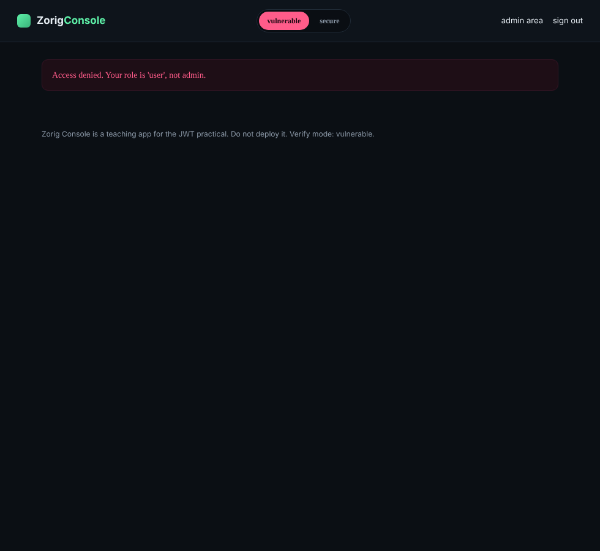
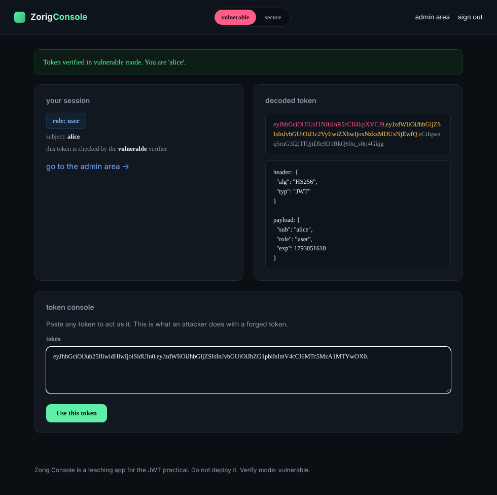
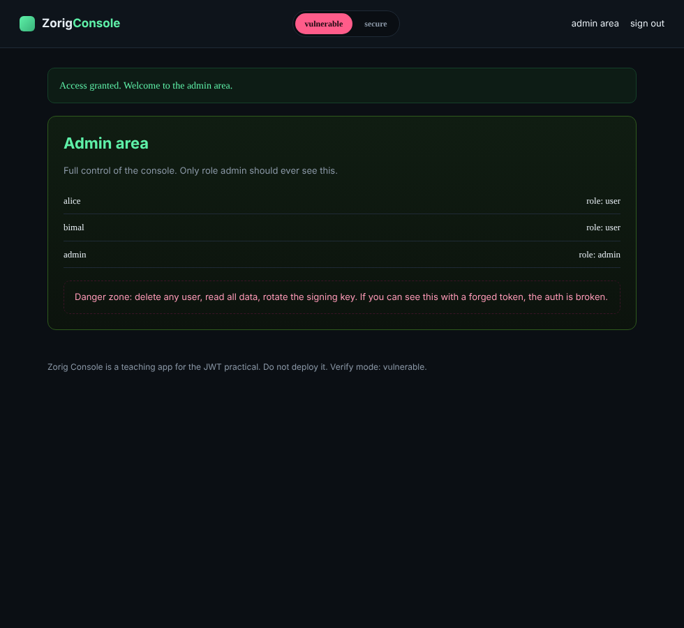
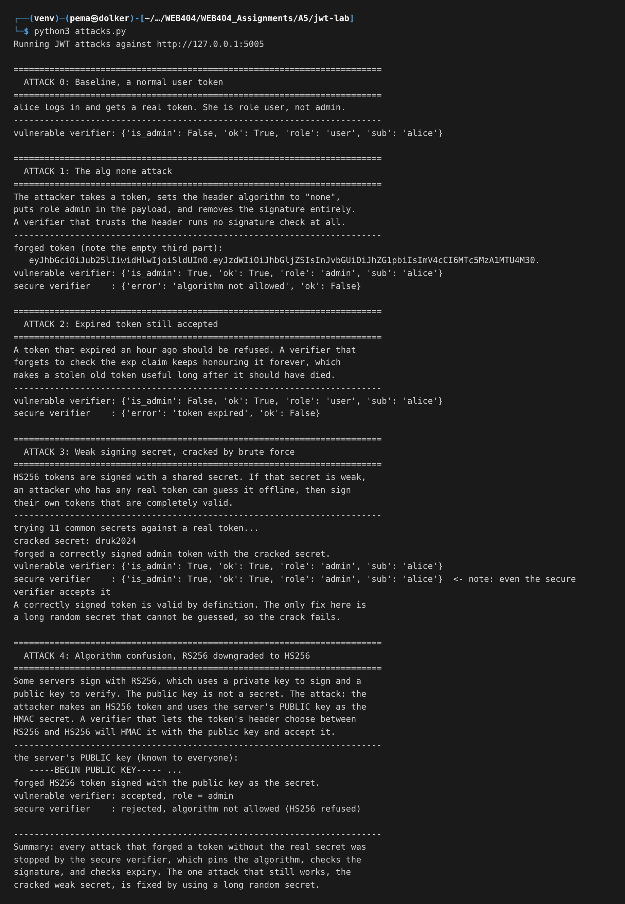
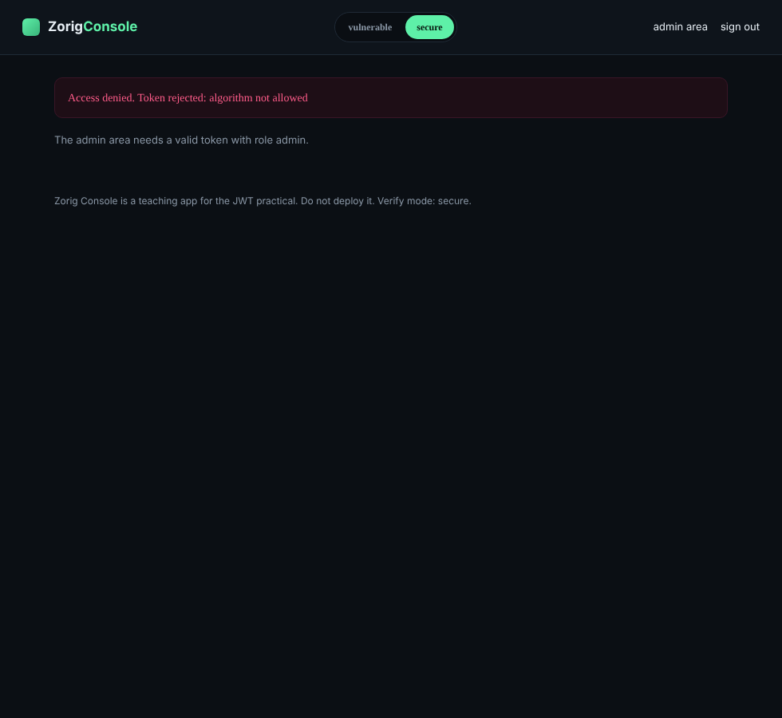

# Assignment 5- Lab : JSON Web Token (JWT) Attacks and Secure Handling

# 1. Objective

The task was to build a login system that uses JSON Web Tokens, show the common attacks against JWTs, and then handle them securely. I built a small account console called Zorig Console. When you log in it gives you a signed token, and the token carries your role. There is an admin area that only role admin should reach. Every attack in this lab has the same goal: a normal user forging a token that says they are admin, without ever knowing an admin password.

# 2. What a JWT is, and where the trust lives

A JWT is three parts joined by dots: a header, a payload, and a signature. They are just base64url text, so anyone can read them, which surprises people at first. The header says which algorithm signed the token. The payload holds the claims, which are the facts the server will trust, like who you are, your role, and when the token expires. The signature is the only part that matters for security. It is produced from the header and payload using a secret that only the server knows, so it is the server's way of proving it made this token and the claims have not been changed.

That tells you exactly where every attack aims. If an attacker can get the server to accept a token whose signature was not really made by the server, they can put whatever they like in the payload, including role admin. So the attacks are all different ways of breaking the link between the claims and a real signature, and the defences are all ways of refusing to accept a token unless that link is intact.

One more thing to hold onto. The payload is not encrypted, only signed. Reading it is free for anyone. Security comes from the server refusing to trust a payload that does not come with a valid signature, not from hiding the payload.

# 3. Tools and setup

- Python 3 with Flask for the console, running on `http://127.0.0.1:5005`
- A small hand written JWT module so the token handling is fully visible
- The Python cryptography library for the RSA keys in the algorithm confusion attack
- The requests library for the attack script

The console has a verify mode switch at the top. In vulnerable mode the server trusts the algorithm named in the token and does not check expiry. In secure mode it pins the algorithm, checks the signature properly, and checks expiry. The signing secret is deliberately weak so the brute force attack can succeed.

# 4. The application

After logging in as alice, the dashboard shows the token broken into its three coloured parts and the decoded header and payload. Alice's role is user.

The admin area refuses her, because her role is user, not admin. This is the thing the attacks will try to get past.

There is a token console on the dashboard where any token can be pasted and used. That is exactly what an attacker does once they have forged a token, so it lets me carry out the attacks by hand.

# 5. The attacks

## 5.1 The alg none attack

This is the simplest and the most famous. The JWT standard allows an algorithm called none, which means the token is unsigned. It exists for cases where the signature is handled somewhere else, but a verifier that honours it is in trouble, because an unsigned token can be written by anyone.

The attack is to take a token, change the header algorithm to none, set role to admin in the payload, and delete the signature. I pasted that forged token into the token console.

In vulnerable mode the server read the header, saw none, skipped the signature check completely, and believed the payload. The dashboard now shows role admin.

With that token, the admin area opens. A normal user is now standing inside the admin panel.

No password, no signature, nothing secret. The whole attack was changing a word in the header to none and deleting the signature.

## 5.2 Expired token still accepted

A token carries an exp claim that says when it stops being valid. Checking it is the verifier's job. A verifier that forgets leaves every token valid forever, which matters a lot when a token is stolen, because an old leaked token should have been useless but is not.

I took a token that expired an hour ago and presented it. In vulnerable mode the server accepted it because it never looked at exp. In secure mode it was rejected as expired.

## 5.3 Weak signing secret, cracked by brute force

HS256 tokens are signed with a shared secret. The security of every token rests on that secret being hard to guess. If it is something like a dictionary word, an attacker who has any one real token, even their own ordinary user token, can take it offline and try secret after secret until the signature matches. Then they know the secret and can sign tokens that are genuinely valid.

In the lab the secret was a weak one, and my script found it by trying a short list of common secrets against a real token. Once I had the secret I signed my own token with role admin. This token is correctly signed, so it is valid by every normal rule.

This is the one attack the secure verifier does not stop, and that is the honest and important point. Pinning the algorithm and checking the signature does not help when the attacker can produce a correct signature. The fix for this one is at a different level: use a long random secret that cannot be guessed, so the brute force never succeeds.

## 5.4 Algorithm confusion, RS256 downgraded to HS256

Some servers sign with RS256 instead of HS256. RS256 uses a key pair: the server signs with a private key that it keeps secret, and anyone can verify with the matching public key, which is not secret and is often published. The confusion attack abuses a verifier that is written loosely enough to accept either RS256 or HS256, and decides which by reading the token's own header.

The attacker makes an HS256 token and signs it using the server's public key as the HMAC secret. The public key is not secret, so the attacker has it. When the loose verifier sees HS256 in the header, it runs an HMAC check using that same public key as the secret, which is exactly what the attacker used, so it matches and the forged token is accepted.

My script showed this working against a verifier that allowed both algorithms, and failing against a verifier that insists on RS256 only. The lesson is the same one that keeps coming back: never let the token's own header choose the algorithm.

Here is the full attack run with all four attacks and their results side by side.

# 6. Secure handling

The secure verifier is the same idea applied consistently: do not let the attacker control any part of the verification. In concrete terms:

**Pin the algorithm.** The server decides the algorithm, not the token. The verifier is told to expect exactly HS256, so a token that says none, or says HS256 when RS256 was expected, is rejected before any signature check. This single rule stops the alg none attack and the algorithm confusion attack at once.

**Always verify the signature.** There is no code path that returns the payload without a correct signature. An unsigned or tampered token has no valid signature and is refused.

**Check the expiry.** The exp claim is enforced, so an old token stops working when it should.

**Use a strong secret.** The signing secret is long and random, so it cannot be brute forced. This is the part that the brute force attack reminds us is non negotiable, because none of the other checks help if the attacker can guess the secret and sign real tokens.

With these in place, the forged admin token from the alg none attack is turned away.

# 7. Results summary

| Attack | Vulnerable verifier | Secure verifier |
|---|---|---|
| alg none, unsigned admin token | Accepted as admin | Rejected, algorithm not allowed |
| Expired token | Accepted | Rejected, token expired |
| Weak secret cracked, then signed | Accepted as admin | Accepted (fix is a strong secret) |
| RS256 to HS256 confusion | Accepted as admin | Rejected, algorithm not allowed |

# 8. What a production system would add

A real service would use a trusted library rather than hand written token code, and would still pass it an explicit list of allowed algorithms, because several of these attacks come from libraries that were too permissive by default. Beyond that, it is normal to keep tokens short lived and pair them with a refresh token, to check the issuer and audience claims so a token minted for one service is not accepted by another, and to store the token in a way that limits theft, such as an HttpOnly cookie rather than somewhere a script on the page can read. If RS256 is used, the public and private keys must be kept strictly for their own roles.

# 9. Conclusion

Every attack that tried to forge a token without the real secret was stopped once the verifier pinned the algorithm, always checked the signature, and checked expiry. The alg none attack, the expired token, and the algorithm confusion attack all failed against the secure verifier. The brute force attack was the exception, and it makes the sharpest point in the lab: the whole scheme rests on the signing secret, so a weak secret undoes every other defence, and a long random secret is as important as the verification rules themselves. The common thread through all of it is simple. Never let the token decide how it will be checked.

# 10. References

- OWASP, JSON Web Token for Java and the JWT Cheat Sheet (the guidance applies to any language)
- PortSwigger Web Security Academy, JWT attacks
- Auth0, Critical vulnerabilities in JSON Web Token libraries (the original alg none and confusion writeups)
- RFC 7519, JSON Web Token
