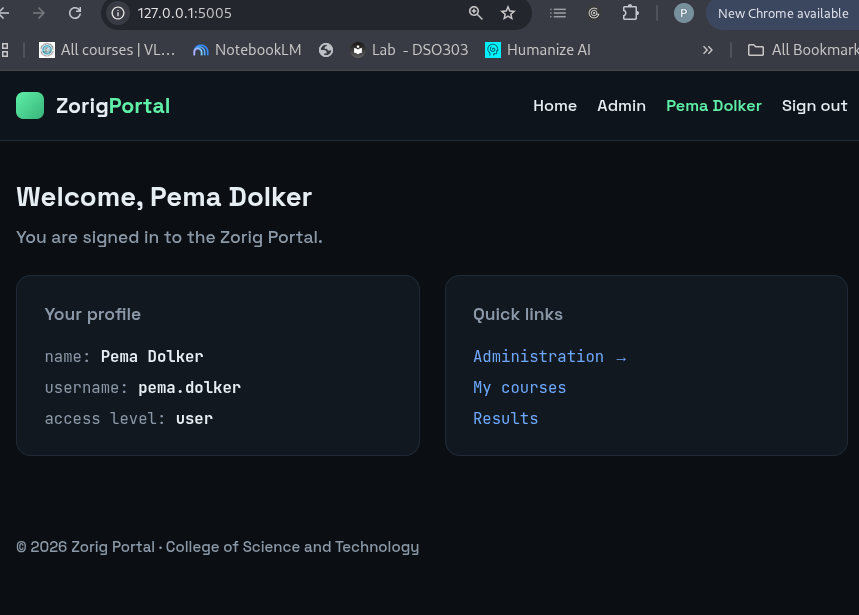
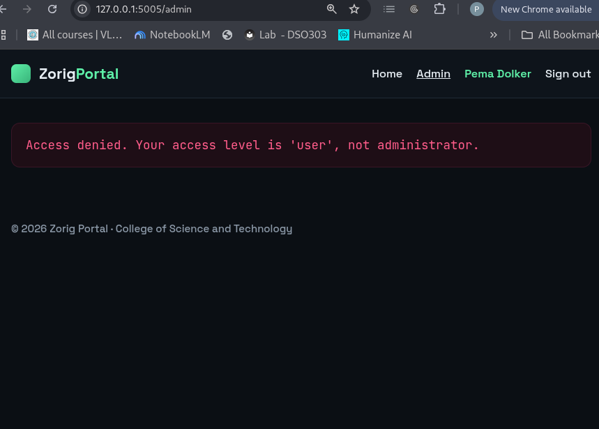
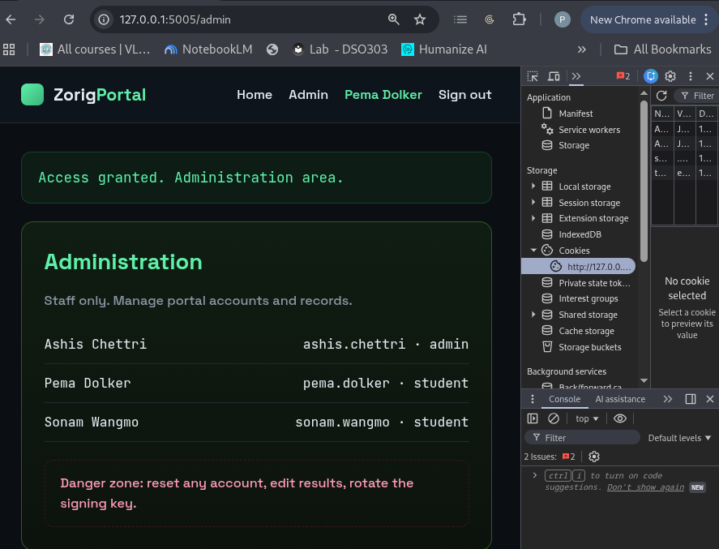
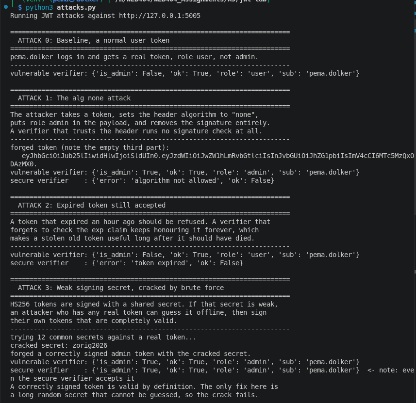
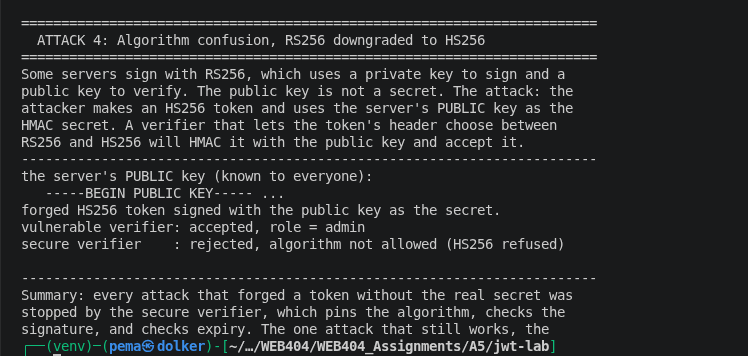
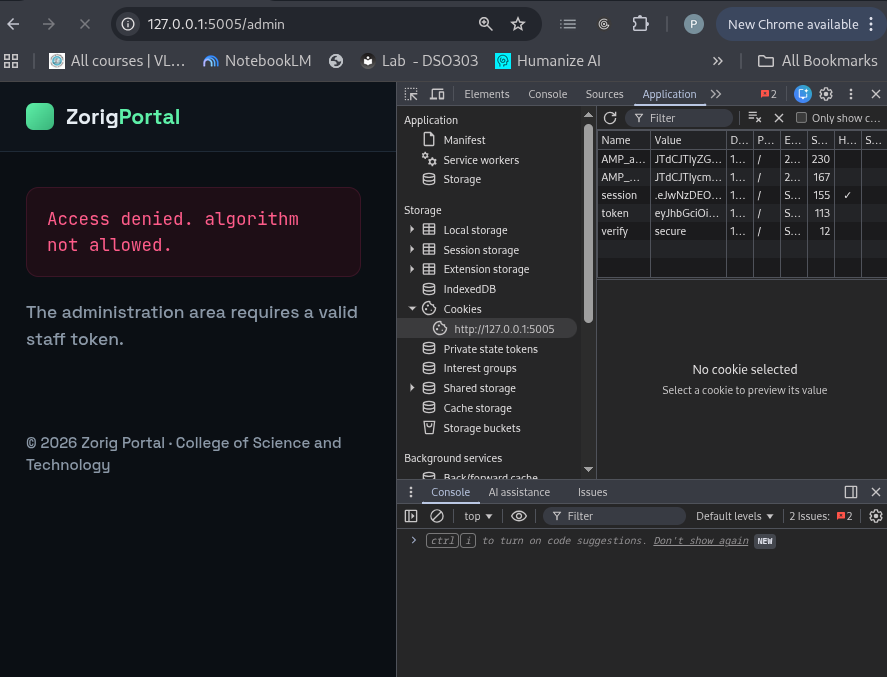

### Assignment 5-  Lab : JSON Web Token (JWT) Attacks and Secure Handling
### Name: Pema Dolker  
### Module: WEB404
### Programme: BE Software Engineering

# 1. Objective

The task was to build a login system that uses JSON Web Tokens, show the common attacks against JWTs, and then handle them securely. I built a staff and student portal called Zorig Portal. When you sign in it issues a signed token, and the token carries your access level. There is an administration area that only administrators should reach. The portal looks like a normal site and nothing on it hints at the flaw. Every attack has the same goal: a normal account forging a token that says administrator, without an admin login.

# 2. What a JWT is, and where the trust lives

A JWT is three parts joined by dots: a header, a payload, and a signature. They are just base64url text, so anyone can read them, which surprises people at first. The header says which algorithm signed the token. The payload holds the claims, the facts the server trusts, like who you are, your access level, and when the token expires. The signature is the only part that matters for security. It is produced from the header and payload using a secret only the server knows, so it is the server's proof that it made the token and the claims have not been changed.

That tells you exactly where every attack aims. If an attacker can get the server to accept a token whose signature was not really made by the server, they can put whatever they like in the payload, including administrator. So the attacks are different ways of breaking the link between the claims and a real signature, and the defences are ways of refusing a token unless that link is intact. One more point: the payload is signed, not encrypted, so reading it is free for anyone. Security comes from the server refusing to trust a payload that does not carry a valid signature, not from hiding it.

# 3. Tools and setup

- Python 3 with Flask for the portal, running on `http://127.0.0.1:5005`
- A small, readable JWT implementation so the token handling is fully visible
- The Python cryptography library for the RSA keys in the algorithm confusion attack
- The requests library for the attack script

The portal has two seeded accounts, both ordinary users, including my own, Pema Dolker. There is an administrator account belonging to the lecturer, Ashis Chettri, but nobody here knows its password; the point is to forge administrator access, not sign in as it. The token verifier runs in two modes used only by this report to show the before and after. The default trusts the algorithm named in the token and ignores expiry, and the hardened mode pins the algorithm, checks the signature and checks expiry. The mode is an internal setting, not shown in the interface.

# 4. The application

After signing in as Pema Dolker, the portal shows a normal dashboard. The access level is user.

The administration area refuses a normal account, because the access level is user, not admin. This is what the attacks try to get past.

# 5. The attacks

To carry a forged token in the browser, an attacker edits the session cookie with the browser developer tools and pastes in their token. That is all the token console in a tool like jwt.io is really doing. In the screenshots below I set the forged token as the cookie exactly that way.

## 5.1 The alg none attack

This is the simplest and most famous. The JWT standard allows an algorithm called none, which means the token is unsigned. A verifier that honours it is in trouble, because an unsigned token can be written by anyone. The attack is to take a token, change the header algorithm to none, set the access level to admin in the payload, and delete the signature.

With that forged token set as the cookie, the portal in its default mode read the header, saw none, skipped the signature check completely, and believed the payload. A student account is now standing inside the administration area, which lists every account.

No password, no signature, nothing secret. The whole attack was changing a word in the header to none and deleting the signature.

## 5.2 Expired token still accepted

A token carries an exp claim saying when it stops being valid, and checking it is the verifier's job. A verifier that forgets leaves every token valid forever, which matters when a token is stolen, because an old leaked token should be useless but is not. I presented a token that expired an hour ago. In the default mode the portal accepted it because it never looked at exp. In the hardened mode it was rejected as expired.

## 5.3 Weak signing secret, cracked by brute force

HS256 tokens are signed with a shared secret, and the security of every token rests on that secret being hard to guess. If it is weak, an attacker who has any one real token, even their own ordinary one, can take it offline and try secret after secret until the signature matches, then sign tokens that are genuinely valid. In the lab the secret was weak, and my script found it by trying a short list of common secrets against a real token. Once I had the secret I signed my own token with access level admin.

This is the one attack the hardened verifier does not stop, and that is the important point. Pinning the algorithm and checking the signature does not help when the attacker can produce a correct signature. The fix for this one is at a different level: use a long random secret that cannot be guessed, so the brute force never succeeds.

## 5.4 Algorithm confusion, RS256 downgraded to HS256

Some servers sign with RS256, which uses a private key to sign and a public key to verify. The public key is not secret and is often published. The confusion attack abuses a verifier that accepts either RS256 or HS256 and decides which by reading the token's own header. The attacker makes an HS256 token and signs it using the server's public key as the HMAC secret. Because the public key is not secret, the attacker has it, and when the loose verifier sees HS256 it runs an HMAC check using that same public key, which matches. My script showed this working against a verifier that allowed both algorithms, and failing against one that insists on RS256 only. The lesson is the same one that keeps returning: never let the token's own header choose the algorithm.

Here is the full attack run with all four attacks and their results.

# 6. Secure handling

The hardened verifier is the same idea applied consistently: do not let the attacker control any part of the verification.

**Pin the algorithm.** The server decides the algorithm, not the token. The verifier expects exactly HS256, so a token that says none, or says HS256 when RS256 was expected, is rejected before any signature check. This single rule stops the alg none attack and the algorithm confusion attack at once.

**Always verify the signature.** There is no code path that returns the payload without a correct signature.

**Check the expiry.** The exp claim is enforced, so an old token stops working.

**Use a strong secret.** The signing secret must be long and random so it cannot be brute forced, which is the part the weak secret attack reminds us is non negotiable.

With these in place, the forged admin token from the alg none attack is turned away.

# 7. Results summary

| Attack | Default verifier | Hardened verifier |
|---|---|---|
| alg none, unsigned admin token | Accepted as admin | Rejected, algorithm not allowed |
| Expired token | Accepted | Rejected, token expired |
| Weak secret cracked, then signed | Accepted as admin | Accepted (fix is a strong secret) |
| RS256 to HS256 confusion | Accepted as admin | Rejected, algorithm not allowed |

# 8. What a production system would add

A real service would use a trusted library rather than hand written token code, and would still pass it an explicit list of allowed algorithms, because several of these attacks come from libraries that were too permissive by default. Beyond that it is normal to keep tokens short lived and pair them with a refresh token, to check the issuer and audience claims so a token minted for one service is not accepted by another, and to store the token in an HttpOnly cookie rather than somewhere a page script can read it. If RS256 is used, the keys must be kept strictly for their own roles.

# 9. Conclusion

Every attack that tried to forge a token without the real secret was stopped once the verifier pinned the algorithm, always checked the signature, and checked expiry. The alg none attack, the expired token, and the algorithm confusion attack all failed against the hardened verifier. The brute force attack was the exception, and it makes the sharpest point in the lab: the whole scheme rests on the signing secret, so a weak secret undoes every other defence. The common thread is simple. Never let the token decide how it will be checked.

# 10. References

- OWASP, JSON Web Token Cheat Sheet
- PortSwigger Web Security Academy, JWT attacks
- Auth0, Critical vulnerabilities in JSON Web Token libraries (the alg none and confusion writeups)
- RFC 7519, JSON Web Token